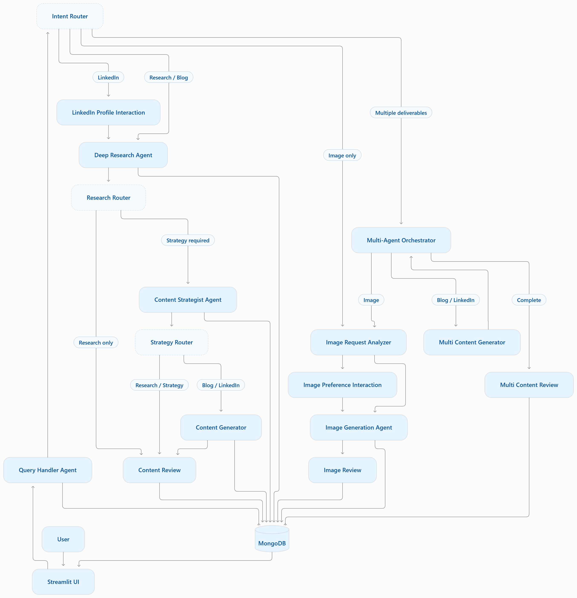

# ContentAlchemy — AI Content Marketing Assistant

ContentAlchemy is a multi-agent content marketing assistant. You describe what you need in a Streamlit chat;
a LangGraph workflow routes the request to specialised agents that research the topic on the web, plan a content
strategy, write an SEO blog or LinkedIn post, or generate a marketing image. Nothing is final until you approve
it: every draft and image pauses for human review.

| You ask for | You get |
|---|---|
| **Research** | A sourced research report (claims linked to real search results), optionally with a content strategy |
| **SEO blog** | A long-form article with SEO title, meta description, slug, keywords, outline, FAQs, CTA, sources and a quality score |
| **LinkedIn post** | A hook, body, call to action and hashtags, written from your professional profile |
| **Image** | A generated image built from an enhanced prompt and your purpose / style / orientation / quality preferences |
| **Multi-content** | Several of the above from one request, coordinated by an orchestrator, each reviewed in its own tab |

---

## Contents

1. [Architecture](#1-architecture)
2. [Technology choices](#2-technology-choices)
3. [Prerequisites and installation](#3-prerequisites-and-installation)
4. [Configuration](#4-configuration)
5. [Agents and API](#5-agents-and-api)
6. [Usage examples](#6-usage-examples)
7. [Troubleshooting](#7-troubleshooting)
8. [Performance and cost optimisation](#8-performance-and-cost-optimisation)
9. [Testing](#9-testing)
10. [Project structure](#10-project-structure)
11. [Further documentation](#11-further-documentation)

---

## 1. Architecture



A request travels **Streamlit UI → application bridge (`assistant.py`) → LangGraph `StateGraph` → agents**.
Agents call LLMs, web search and image providers through integration layers that **retry and fall back** between
providers, and they persist every question, draft and decision to **MongoDB**. Review steps pause the graph with
LangGraph `interrupt()`; the UI resumes it with `Command(resume=...)` when you answer.

| Layer | Location | Responsibility |
|---|---|---|
| Presentation | `src/web_app/` | Chat, Content (review) tab, Content dashboard, Architecture view, sidebar (content type, brand voice, history) |
| Application bridge | `src/web_app/assistant.py` | Creates conversations, runs/resumes graph threads, records pauses, failures and final content |
| Orchestration | `src/core/` | `workflow.py` (graph + routers), `state.py` (`ContentState`), `router.py`, `brand_voice.py`, `logger.py` |
| Agents | `src/agents/` | One LangGraph node per responsibility (see [§5](#5-agents-and-api)) |
| Prompts | `src/prompts/` | System prompts for research, strategy, SEO blog, LinkedIn and image prompt engineering |
| Guardrails | `src/guardrails/`, `src/utils/quality_validation.py` | Pydantic I/O validation, prompt-injection heuristics, source grounding, output safety, quality scoring |
| Integrations | `src/integrations/`, `src/tools/` | Text provider manager (OpenAI / Claude / Gemini / Perplexity), image provider manager (Stability / OpenAI / Gemini), SerpApi → Tavily search, Azurite blob storage |
| Data | `src/repositories/` | `users`, `user_profiles`, `conversations`, `messages` collections |

Per-workflow diagrams (exported from the in-app **Architecture** page) live in [`docs/images/`](docs/images/) and
are explained in [docs/architecture.md](docs/architecture.md):

| Workflow | Diagram |
|---|---|
| System overview | [architecture_system_overview.png](docs/images/architecture_system_overview.png) |
| SEO blog | [architecture_seo_blog.png](docs/images/architecture_seo_blog.png) |
| LinkedIn | [architecture_linkedin.png](docs/images/architecture_linkedin.png) |
| Research | [architecture_research_agent.png](docs/images/architecture_research_agent.png) |
| Content strategist | [architecture_content_strategist.png](docs/images/architecture_content_strategist.png) |
| Image | [architecture_image.png](docs/images/architecture_image.png) |
| Multi-content | [architecture_multi_content.png](docs/images/architecture_multi_content.png) |

---

## 2. Technology choices

| Concern | Choice | Why | Alternatives considered |
|---|---|---|---|
| Agent orchestration | **LangGraph 1.2** `StateGraph` | Explicit, inspectable graph; conditional edges; first-class `interrupt()` / `Command(resume)` for human-in-the-loop; checkpointed threads | CrewAI, AutoGen (less control over pause/resume), plain Python state machine (re-implements checkpointing) |
| UI | **Streamlit 1.66** | Fast to build chat + review UIs in Python; `st.navigation`, pills, `st.cache_data` | Gradio, React + FastAPI (more work, better multi-user scaling) |
| Primary LLM | **OpenAI `gpt-4o-mini`** via the Responses API | Low cost, fast, reliable JSON output | Claude, Gemini, Perplexity — all wired in as fallbacks |
| LLM resilience | Custom **`TextProviderManager`** | Ordered fallback, bounded exponential-backoff retries, error classification, stream-safe fallback | LiteLLM / OpenRouter (external dependency or proxy) |
| Web search | **SerpApi (Google)** → **Tavily** fallback | Google organic results first; Tavily as an LLM-oriented, cheaper backup | Bing/Brave Search API, Exa, Perplexity Sonar (search + answer in one) |
| Images | **Stability AI Stable Image Core** → OpenAI `gpt-image` → Gemini image | Cheapest per image first; fallback across three vendors | DALL·E 3, Midjourney (no official API), self-hosted SDXL |
| Persistence | **MongoDB** (`pymongo`) | Flexible documents for heterogeneous drafts (blog JSON, LinkedIn fields, image metadata) | PostgreSQL + JSONB, SQLite (single-user) |
| Image storage | **Azure Blob Storage** (Azurite emulator locally) | Same API locally and in Azure | S3 / MinIO, local disk only |
| Validation | **Pydantic v2** | Strict schemas (`extra="forbid"`) for LLM I/O | JSON Schema, Guardrails AI, NeMo Guardrails |
| Observability | Rotating file logs + per-node timing; optional **LangSmith** tracing | Zero-cost baseline; LangSmith when you need traces | OpenTelemetry, Langfuse |

A deeper discussion of trade-offs is in the [Technical Design Document](docs/technical-design-document.md); a
vendor-by-vendor cost and quality comparison is in the [AI Service Comparison](docs/service-comparison.md).

---

## 3. Prerequisites and installation

### Prerequisites

| Requirement | Version | Notes |
|---|---|---|
| Python | 3.11+ (developed on 3.13) | |
| MongoDB | 6.0+ (local, Docker or Atlas) | Required for conversations, history and the dashboard |
| Azurite or Azure Storage | latest | Stores generated images (see [Troubleshooting](#7-troubleshooting)) |
| API keys | — | **Required:** `OPENAI_API_KEY`, `SERPAPI_KEY` (or `TAVILY_API_KEY`). **Optional:** Anthropic, Gemini, Perplexity, Stability, Tavily, LangSmith |
| Docker | 24+ | Optional, for the containerised stack |

### Option A — local Python

```bash
git clone <your-repo-url> contentalchemy
cd contentalchemy

python -m venv .venv
# Windows:  .venv\Scripts\activate
# macOS/Linux: source .venv/bin/activate
pip install -r requirements.txt

cp .env.example .env              # then fill in your keys (see §4)

# MongoDB: create collections, indexes and the default user (idempotent)
mongosh "mongodb://127.0.0.1:27017" scripts/init_mongodb.js

# Azurite (images): run the emulator, then create the blob container once
docker run -d -p 10000:10000 --name azurite mcr.microsoft.com/azure-storage/azurite \
  azurite-blob --blobHost 0.0.0.0 --skipApiVersionCheck --loose
python -m tests.test_azurite      # creates AZURITE_CONTAINER_NAME if it doesn't exist

streamlit run src/web_app/streamlit_app.py
```

Open <http://localhost:8501>.

### Option B — Docker Compose

```bash
cp .env.example .env              # fill in your keys
docker compose up -d --build      # app + MongoDB + Azurite (+ one-shot container/index setup)
```

The compose file overrides `MONGODB_URI` and the Azurite settings so the app talks to the other containers.
See the [Deployment Guide](docs/deployment-guide.md) for details, production settings and Atlas/Azure.

---

## 4. Configuration

All settings are environment variables loaded from `.env` by `python-dotenv`. The table lists every variable the
code reads (`os.getenv`), plus the LangSmith variables read by LangChain itself.

### LLM providers

| Variable | Default | Used by | Purpose |
|---|---|---|---|
| `OPENAI_API_KEY` | — (**required**) | `openai_client.py`, `openai_provider.py` | OpenAI text + images. Also required by the image agents and general chat, which call OpenAI directly |
| `OPENAI_MODEL` | `gpt-4o-mini` | `openai_client.py`, `blog_writer.py` | OpenAI text model |
| `ANTHROPIC_API_KEY` | — | `claude_client.py` | Claude fallback |
| `CLAUDE_DEFAULT_MODEL` | `claude-sonnet-5-5` | `claude_client.py` | Claude model |
| `GEMINI_API_KEY` | — | `gemini_client.py`, `gemini_provider.py` | Gemini text fallback and Gemini images |
| `GEMINI_DEFAULT_MODEL` | `gemini-2.5-flash` | `gemini_client.py` | Gemini text model |
| `PERPLEXITY_API_KEY` | — | `perplexity_client.py` | Perplexity fallback |
| `PERPLEXITY_DEFAULT_MODEL` | `perplexity/sonar` | `perplexity_client.py` | Perplexity model |
| `TEXT_PRIMARY_PROVIDER` | `openai` | `text_provider_manager.py` | First provider tried: `openai`, `claude`, `gemini`, `perplexity` |
| `TEXT_FALLBACK_PROVIDERS` | *(empty)* | `text_provider_manager.py` | Comma-separated fallback order, e.g. `claude,gemini,perplexity` |

> `DEFAULT_MODEL` appears in older `.env` files but **is not read by the code**. Set `OPENAI_MODEL` to change the
> OpenAI model.

### Web search

| Variable | Default | Purpose |
|---|---|---|
| `SERPAPI_KEY` | — | Google search via SerpApi (primary) |
| `TAVILY_API_KEY` | — | Tavily search (fallback when SerpApi errors or returns no valid results) |

At least one search key is needed; research raises *"No search results found"* if both fail.

### Image generation

| Variable | Default | Purpose |
|---|---|---|
| `IMAGE_PRIMARY_PROVIDER` | `stability` | `stability`, `openai` or `gemini`. **Must also be enabled** below or startup fails |
| `IMAGE_FALLBACK_PROVIDERS` | *(empty)* | Comma-separated, e.g. `openai,gemini` |
| `STABILITY_IMAGE_ENABLED` / `OPENAI_IMAGE_ENABLED` / `GEMINI_IMAGE_ENABLED` | `false` | Register each provider (`true` / `false`) |
| `STABILITY_API_KEY` | — | Required when Stability is enabled |
| `STABILITY_IMAGE_MODEL` | `core` | Logged; the endpoint is Stable Image Core |
| `OPENAI_IMAGE_MODEL` | `gpt-image-1` | OpenAI image model |
| `GEMINI_IMAGE_MODEL` | `gemini-3.1-flash-image` | Gemini image model (needs a billing-enabled key) |
| `IMAGE_TIMEOUT_SECONDS` | `120` | Stability HTTP timeout |

`IMAGE_PROVIDER` (present in `.env.example`) is not read by the current code.

### Storage, database and app

| Variable | Default | Purpose |
|---|---|---|
| `MONGODB_URI` | — (**required**) | e.g. `mongodb://127.0.0.1:27017` or an Atlas `mongodb+srv://` URI |
| `MONGODB_DATABASE` | `contentalchemy_db` | Database name |
| `AZURITE_ACCOUNT_NAME` | `devstoreaccount1` | Blob account name |
| `AZURITE_ACCOUNT_KEY` | — (**required at import**) | Blob account key. `image_clients.py` builds the storage client when the workflow is imported |
| `AZURITE_BLOB_ENDPOINT` | `http://127.0.0.1:10000/devstoreaccount1` | Blob endpoint |
| `AZURITE_CONTAINER_NAME` | `contentalchemy-images` | Container for generated images (must exist) |
| `CONTENTALCHEMY_USER_ID` | `usr_local_001` | User the single-user app runs as |
| `LANGCHAIN_TRACING_V2`, `LANGCHAIN_API_KEY`, `LANGCHAIN_PROJECT` | — | Optional LangSmith tracing (read by LangChain/LangGraph) |

Streamlit theming lives in `.streamlit/config.toml`. The files in `config/` (`development.yaml`,
`production.yaml`, `services.yaml`) are empty placeholders and are not loaded.

---

## 5. Agents and API

ContentAlchemy has no HTTP API; its interface is the Streamlit UI, backed by a Python API in
`src/web_app/assistant.py` and a compiled LangGraph graph. Full signatures, interrupt payloads and resume formats
are in the [API Reference](docs/api-reference.md).

### Agents (LangGraph nodes)

| Node | Module | Does | Pauses? |
|---|---|---|---|
| `query_handler` | `agents/query_handler.py` | LLM classifies intent, topic, audience, tone, keywords, objective, requested deliverables (Pydantic-validated) | |
| `linkedin_profile_interaction` | `agents/linkedin_interaction.py` | Asks 5 profile questions (identity, role, objective, experience, tone) | ⏸ ×5 |
| `research_agent` | `agents/research_agent.py` | Web search (5 results) → injection scan → LLM synthesis to JSON → schema + grounding checks → Markdown report | |
| `content_strategist` | `agents/content_strategist.py` | One LLM call produces a research report **and** a content strategy, split on `---CONTENT_STRATEGY_START---` | |
| `content_generator` | `agents/content_generator.py` | Writes the LinkedIn post or streams the SEO blog; output guardrails; quality score | |
| `content_review` | `agents/content_review.py` | Approve / edit (re-scored, loops back) / reject | ⏸ |
| `image_request_analyzer` | `agents/image_preferences.py` | Extracts purpose, style, orientation, quality already in the request | |
| `image_preference_interaction` | `agents/image_preferences.py` | Asks for each missing preference, one per run | ⏸ per question |
| `image_generator` | `agents/image_generator.py` | Enhances the prompt, generates via provider manager, stores and persists the image | |
| `image_review` | `agents/image_review.py` | Approve / edit prompt / regenerate / reject | ⏸ |
| `multi_agent_orchestrator` | `agents/multi_agent_orchestrator.py` | Picks the next unfinished deliverable | |
| `multi_content_generator` | `agents/content_generator.py` | Blog / LinkedIn writer in multi mode | |
| `multi_content_review` | `agents/content_review.py` | Reviews each text deliverable in turn | ⏸ per deliverable |

### Python API at a glance

```python
from src.web_app.assistant import start_agent, answer_question, submit_decision, get_current_user

user = get_current_user()
settings = {"audience": "Marketers", "tone": "Professional", "keywords": "AI, B2B marketing"}

conversation_id, payload, state = start_agent(
    user["user_id"], "research", "Research AI adoption trends in B2B marketing", settings,
)
# payload is the pending interrupt, e.g. {"interaction_type": "content_review", "content": "...", ...}

payload, state = submit_decision(
    user["user_id"], conversation_id, "research", draft=payload["content"], action="approve",
)
```

---

## 6. Usage examples

Pick a content type in the sidebar (or leave **Auto**, which routes by keywords such as *linkedin*, *blog*,
*image*, *research*), optionally set **Brand voice** (tone, audience, keywords), and type a request.

### Research

> *Research AI adoption trends in B2B marketing*

Query Handler → Deep Research Agent → **Content Review**. You get `# Research: …` with a summary, numbered key
findings (each with links to the search results it came from) and a source list. Ask for a strategy too
(*"…and a content strategy"*) to route through the Content Strategist.

### SEO blog

> *Write an SEO blog about zero-trust security for small businesses*

Research → Content Strategist → Content Generator. The article **streams** into the chat as it is written, then
appears in the Content tab with SEO metadata, outline, FAQs, sources and a **quality score** (e.g. `78/100 — Good`)
with suggestions. Edit it in place: the edit is re-scored and returned to review.

### LinkedIn post

> *LinkedIn post about what I learned building a multi-agent system with LangGraph*

You answer five quick questions (multi-select plus *Other*), then research and strategy run and the writer returns
a hook, body, CTA and up to 15 hashtags, shaped by your profile and tone.

### Image

> *A minimalist landscape banner of a rocket made of data charts, HD*

The analyzer finds *minimalist*, *landscape* and *HD* in the request and asks only for the missing **purpose**.
The generator writes a detailed prompt and calls the configured image providers in order. In review you can approve
(and download the PNG), edit the prompt, regenerate with the same prompt, or reject.

### Multi-content

> *Create a LinkedIn post and an SEO blog about AI agents in customer support, with an image*

LinkedIn questions → research → strategy → the orchestrator runs the blog writer, LinkedIn writer and image chain in
turn. Each deliverable gets its own tab in the Content page; a failed image does not stop the text pieces. Approved
pieces land in the **Content dashboard**, where they can be previewed, edited, downloaded as Markdown or removed.

---

## 7. Troubleshooting

| Symptom | Cause | Fix |
|---|---|---|
| `MONGODB_URI is missing from .env` | Variable not set | Add `MONGODB_URI` to `.env` |
| History and dashboard are empty, logs show `ServerSelectionTimeoutError` | MongoDB unreachable (5 s timeout) | Start MongoDB; in Docker use `mongodb://mongodb:27017` |
| `AZURITE_ACCOUNT_KEY is missing.` on startup | `image_clients.py` creates the blob client at import, so every workflow needs it | Set `AZURITE_ACCOUNT_KEY` (the Azurite dev key is in `docker-compose.yml`) |
| `ContainerNotFound` when saving an image | Blob container doesn't exist; the app never creates it | Create it once: `docker compose` does this via `azurite-init`; locally run `python -m tests.test_azurite` |
| `Unsupported image provider: stability` on startup | `IMAGE_PRIMARY_PROVIDER` isn't enabled | Set `STABILITY_IMAGE_ENABLED=true` (or change the primary) |
| *"Image generation is unavailable because the configured image provider has insufficient credits"* | Every enabled provider returned a credit/quota error | Top up Stability credits, or enable `openai` / `gemini` as fallbacks |
| OpenAI image: `Invalid size '1024x1792'` / `model 'gpt-image-1' does not exist` | Size or model not available on your account | Set `OPENAI_IMAGE_MODEL` to a model you can access; portrait/landscape sizes differ by model |
| Gemini image: *"Image models need a paid (billing-enabled) Gemini API key"* | Free-tier key | Enable billing or disable Gemini images |
| Image generates but the step then fails with `TypeError: string indices must be integers` | Known defect: `image_clients.py` uses `AzuriteImageStorage` directly, whose `upload_image()` returns a URL string, but the caller expects a dict | Switch `image_clients.py` to `ImageStorageManager` (returns `{image_path, image_url}`). Note that the UI reads images from a local path, so local storage is what the review screen can display |
| `Content generation failed. All configured providers were unsuccessful` | Every text provider failed; the message lists each reason | Check keys/quotas; add fallbacks to `TEXT_FALLBACK_PROVIDERS` |
| `Query Handler returned invalid JSON` / `Research agent returned invalid JSON` | Model returned non-JSON | Retry; prefer `gpt-4o-mini` or Claude as primary; Perplexity is least reliable for strict JSON |
| `Finding N cites a URL not present in the original search results` | Grounding guardrail rejected a hallucinated source | Retry; this is the guardrail working |
| After a restart, *"This image can no longer be regenerated"* | `MemorySaver` checkpoints are in memory only | Approve/reject the existing draft or start a new conversation |
| Running `pytest` makes real API calls | `tests/test_stability_image.py`, `test_azurite.py` and others execute at **import** | Run selected files, e.g. `pytest tests/test_query_handler.py`, or `--ignore` the script-style files |
| Logs print `Key loaded: True / Key length / Base64 valid` | Debug `print()` calls at import in `image_storage.py` | Harmless; remove them for production |

Logs are written to stdout and `logs/contentalchemy.log` (5 MB × 3 rotations). Every node logs
`Node finished | Node: … | Status: completed|interrupted|failed | Execution time: …`.

---

## 8. Performance and cost optimisation

### Measured latency

Median node time from `logs/contentalchemy.log` (28 Oct – 13 Nov 2026, OpenAI `gpt-4o-mini` primary, mocked test
runs excluded):

| Step | Median | p90 | Main cost driver |
|---|---|---|---|
| Query handler | 2.9 s | 3.9 s | 1 LLM call, ≤ 700 output tokens |
| Research agent | 14.3 s | 19.4 s | Web search (avg 2.8 s) + LLM synthesis (avg 14.8 s, ≤ 3,000 tokens) |
| Content strategist | 20.9 s | 31.4 s | Largest call: ≤ 7,000 output tokens |
| Content generator | 6.5 s | 18.9 s | Blog ≤ 4,000 tokens (streamed), LinkedIn ≤ 1,600 |
| Image request analyzer | 1.5 s | 1.8 s | ≤ 200 tokens |
| Image generator | 5.8 s | 6.5 s | Prompt enhancement + provider call |

A full SEO blog run is typically **45–60 s** of compute, plus however long you take to review.

### Levers

| Lever | Where | Effect |
|---|---|---|
| Keep a cheap, fast primary (`gpt-4o-mini`) and use stronger models only as fallbacks | `TEXT_PRIMARY_PROVIDER`, `OPENAI_MODEL` | Biggest single cost lever; see [service comparison](docs/service-comparison.md) |
| Lower `max_output_tokens` on the strategist (7,000) | `content_strategist.py` | Strategist is the slowest and most expensive step |
| Research-only requests skip the strategist | `route_after_research` | Already saves one large call per research request |
| Reduce search results (`num_results=5`) | `research_agent_node` | Fewer input tokens in synthesis |
| Prefer Tavily as primary when Google-specific results aren't needed | `serp_client.search_web` | Tavily basic search costs a fraction of a SerpApi search |
| Stability Core first for images | `IMAGE_PRIMARY_PROVIDER=stability` | About $0.03 per image vs. more per image for most alternatives |
| **Regenerate** reuses the enhanced prompt (no LLM call) | `image_generator_node` | Cheaper than *edit* |
| UI caching | `st.cache_resource` (compiled graph), `st.cache_data` (history 5 min, user 10 min) | Fewer MongoDB round-trips |
| Run `scripts/init_mongodb.js` | MongoDB | Creates the indexes the history and dashboard queries need (the app doesn't create them) |
| Trace selectively | `LANGCHAIN_TRACING_V2` | LangSmith tracing adds network calls; enable it only when you need it |

---

## 9. Testing

```bash
pytest tests/test_query_handler.py tests/test_input_guardrails.py tests/test_research_guardrails.py \
       tests/test_grounding_guardrails.py tests/test_prompt_injection_guard.py \
       tests/test_content_output_guardrails.py tests/test_text_provider_fallback.py \
       tests/test_text_provider_retries.py tests/test_text_provider_streaming.py \
       tests/test_image_provider_manager.py tests/test_multi_content_workflow.py \
       tests/test_content_strategist.py tests/test_content_workflow_errors.py tests/test_workflow.py
```

The suite has about 116 test functions (guardrails, provider fallback/retries/streaming, query handler, multi-content
workflow, workflow compilation and error paths). Several files (`test_azurite.py`, `test_mongodb.py`,
`test_stability_image.py`, `test_*_repository.py`, `test_research_agent.py`, `test_text_provider_manager.py`) are
scripts that run when imported. **Even `pytest --collect-only` executes them**, which can call paid APIs and write
to MongoDB, so list test files explicitly as shown above.

---

## 10. Project structure

```
contentalchemy/
├── README.md                     ← this guide
├── Dockerfile / docker-compose.yml / .dockerignore
├── requirements.txt / .env.example
├── .streamlit/config.toml        theme
├── docs/                         architecture, design, comparison, API, deployment + images/
├── scripts/init_mongodb.js       collections, indexes, validators, default user
├── inputs/user_profile.md        sample LinkedIn profile
├── src/
│   ├── agents/                   LangGraph nodes
│   ├── core/                     workflow, state, router, brand voice, logger, config
│   ├── guardrails/               input, injection, research, grounding, tool, output
│   ├── integrations/             text/image provider managers + clients, search, storage, MongoDB
│   ├── prompts/                  system prompts
│   ├── repositories/             users, user_profiles, conversations, messages
│   ├── tools/                    LangChain tools (legacy tool-calling blog agent)
│   ├── utils/                    quality validation, profile helper
│   └── web_app/                  Streamlit app, components, styles
└── tests/
```

---

## 11. Further documentation

| Document | Contents |
|---|---|
| [docs/architecture.md](docs/architecture.md) | System and per-workflow diagrams, request flow, layers |
| [docs/technical-design-document.md](docs/technical-design-document.md) | Design decisions, LangGraph state, HITL, guardrails, fallback, scalability, observability |
| [docs/service-comparison.md](docs/service-comparison.md) | OpenAI vs Claude vs Gemini vs Perplexity, SerpApi vs Tavily, image providers, costs, recommendations |
| [docs/api-reference.md](docs/api-reference.md) | Python API, graph nodes, interrupt payloads, state fields, repositories, provider interfaces |
| [docs/deployment-guide.md](docs/deployment-guide.md) | MongoDB collections and indexes, init script, Docker, environment and production deployment |
