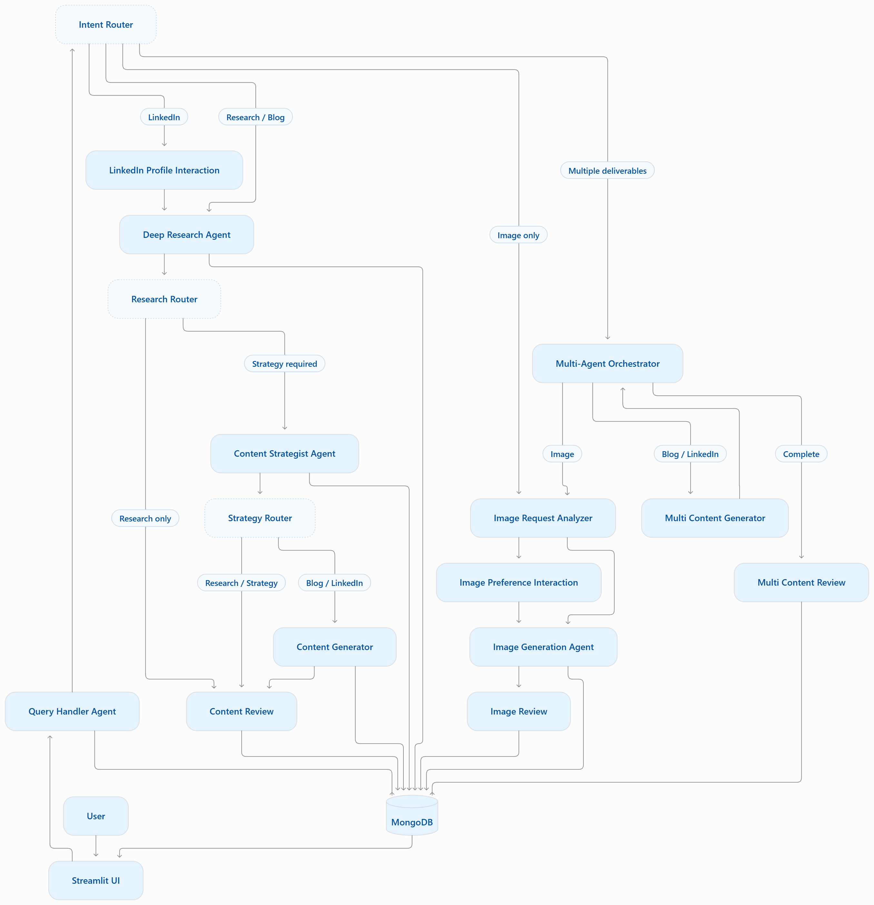
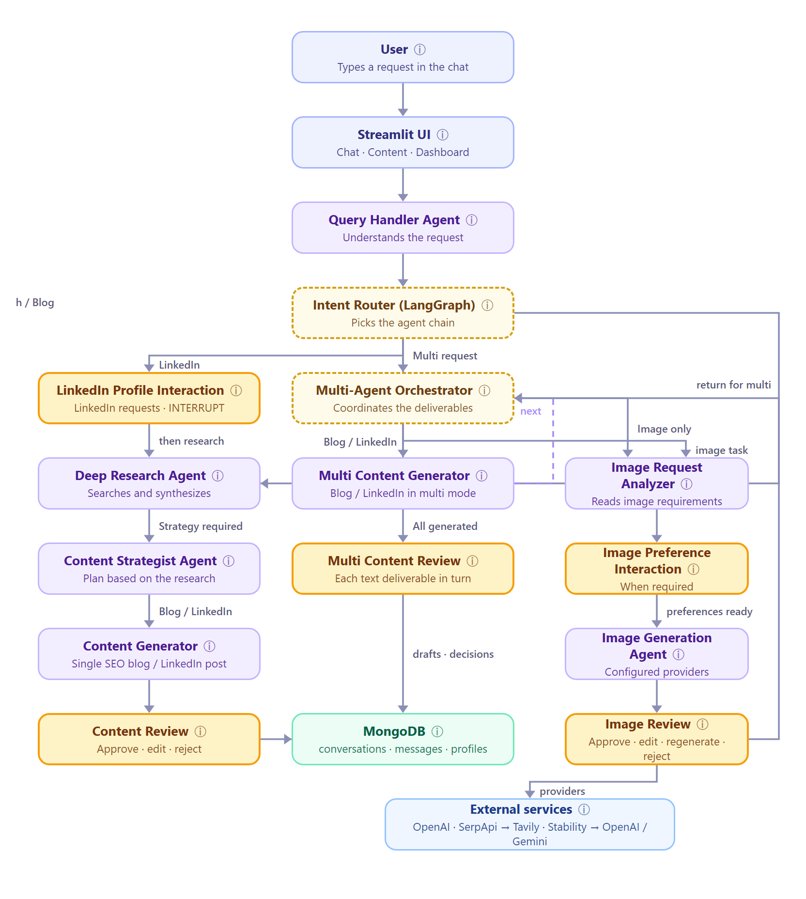
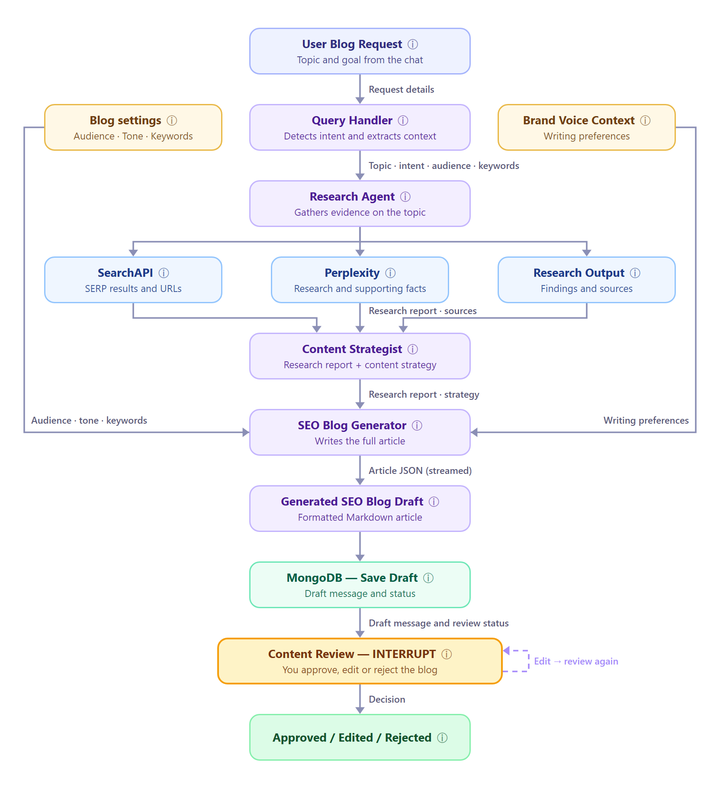
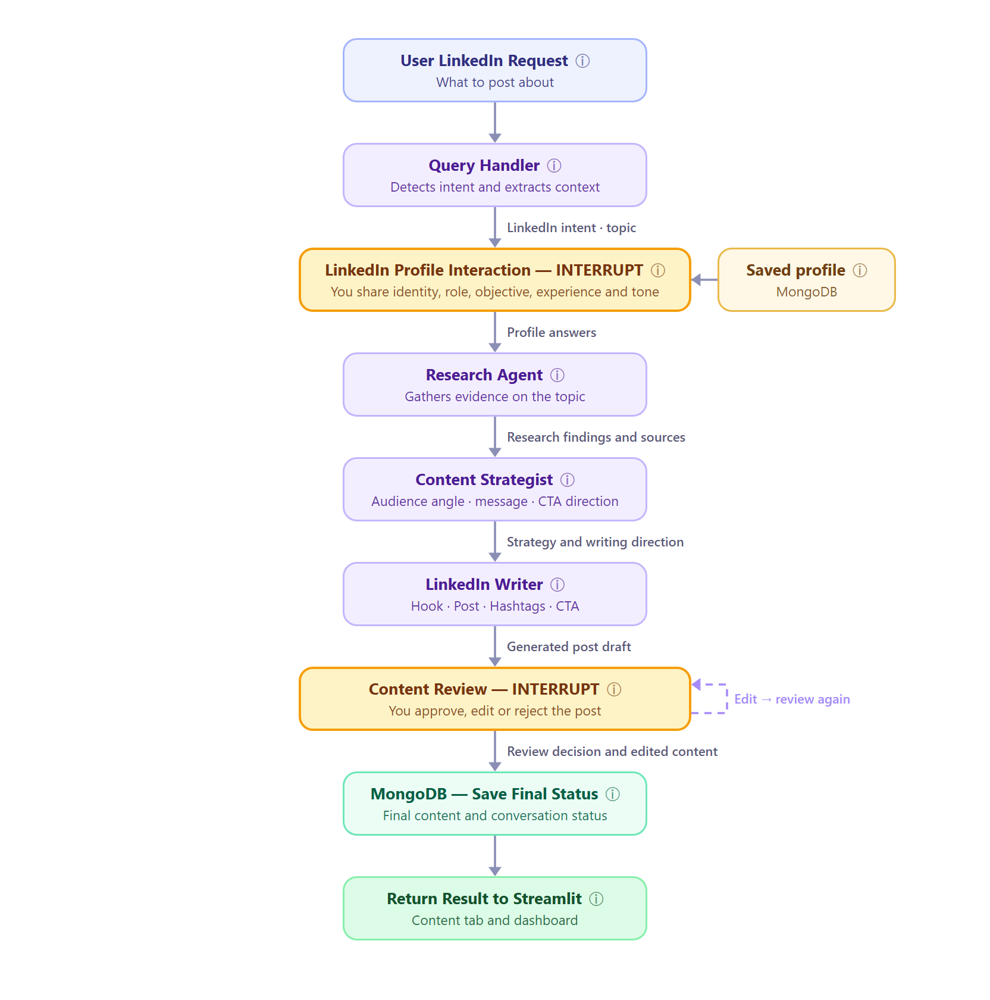
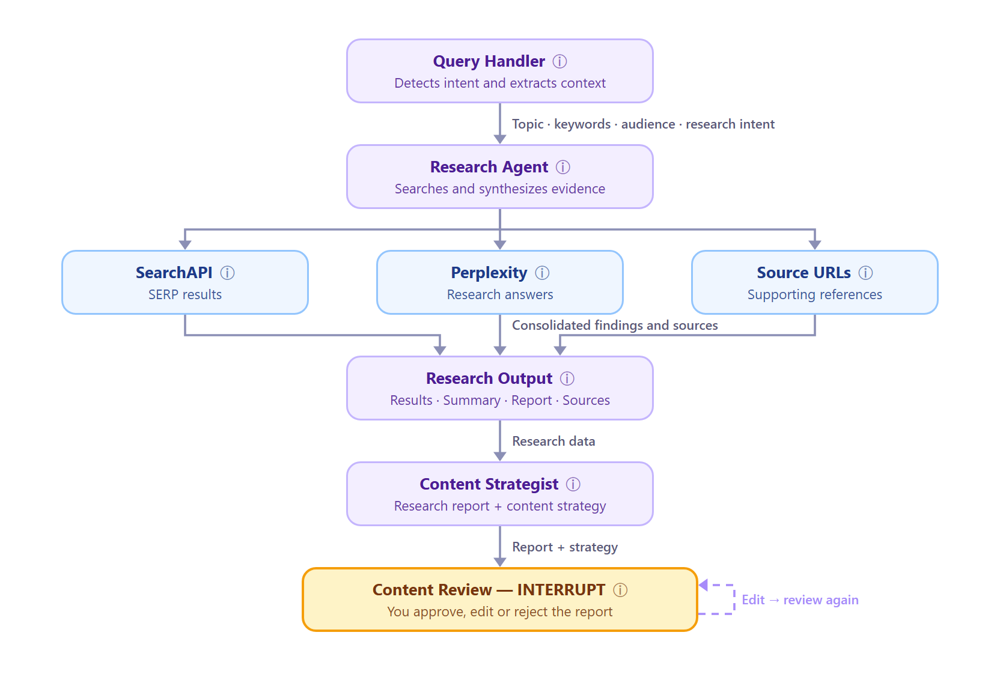
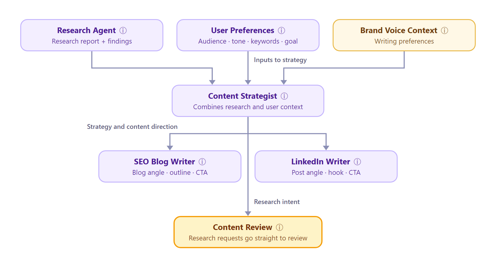
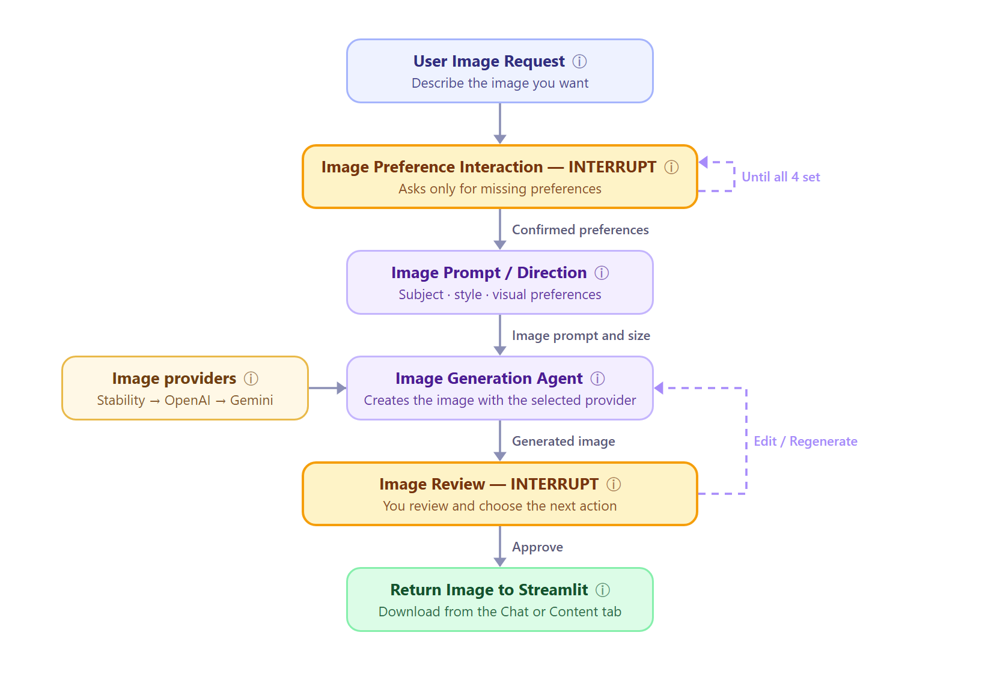
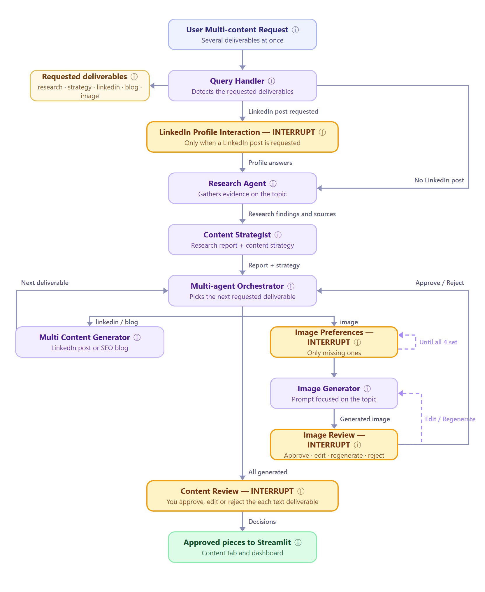
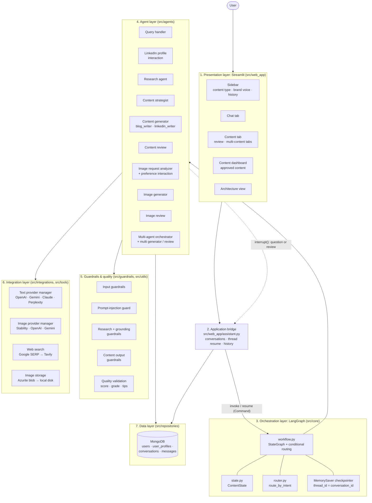

# ContentAlchemy Architecture

ContentAlchemy is a multi-agent content marketing assistant. A Streamlit UI sends the user's request into a
LangGraph workflow. Specialized agents research the topic, plan a strategy, write content (research report,
SEO blog, LinkedIn post), generate images, and pause for human review before anything is approved.

## 1. System architecture

The diagram shows a request's path from the user, through the LangGraph agents, and into MongoDB.
Solid boxes are agents (LangGraph nodes). Dashed boxes are **routers**: decision points in
`src/core/workflow.py` that pick the next agent. They are routing functions, not agents.

### How a request flows

1. **User → Streamlit UI → Query Handler Agent.** The user picks a content type in the sidebar and types a request.
   The Query Handler validates it and classifies the intent, the topic and, for multi-content, the requested deliverables.
2. **Intent Router** (`route_after_query_handler`) sends the request down one of four paths:
   - **LinkedIn** → LinkedIn Profile Interaction asks the profile questions, then continues to the Deep Research Agent.
   - **Research / Blog** → straight to the Deep Research Agent.
   - **Image only** → Image Request Analyzer.
   - **Multiple deliverables** → Multi-Agent Orchestrator. A multi request that includes a LinkedIn post or any
     text deliverable first goes through the LinkedIn questions and/or research and strategy, then reaches the orchestrator.
3. **Research Router** (`route_after_research`), after the Deep Research Agent:
   - **Research only** (no strategy requested) → Content Review.
   - **Strategy required** → Content Strategist Agent.
4. **Strategy Router** (`route_after_strategy`), after the Content Strategist:
   - **Research / Strategy** → Content Review (the research report plus the content strategy).
   - **Blog / LinkedIn** → Content Generator → Content Review.
   - **Multi** → Multi-Agent Orchestrator.
5. **Multi-Agent Orchestrator** loops over the requested deliverables. It sends each one to the right agent and
   gets control back when that agent finishes:
   - **Blog / LinkedIn** → Multi Content Generator → back to the orchestrator.
   - **Image** → the image path (analyzer → preferences → generation → review) → back to the orchestrator.
   - **Complete** → Multi Content Review, where each text deliverable is reviewed in turn.
6. **Image path:** the Image Request Analyzer reads the preferences already in the request (purpose, style,
   orientation, quality). Image Preference Interaction asks for any that are missing, one question at a time.
   The Image Generation Agent then creates the image, and Image Review lets the user approve, edit, regenerate or reject it.
7. **MongoDB:** every agent saves its output (questions, answers, drafts, quality scores, final content) to
   MongoDB. The Streamlit UI reads it back for History, the Content tab and the Content dashboard.

### Loops not drawn in the diagram

- **Pausing for the user:** LinkedIn Profile Interaction, Image Preference Interaction, Content Review,
  Multi Content Review and Image Review pause the workflow with `interrupt()`. The UI shows the question or
  draft, and the thread resumes when the user answers.
- **Content Review:** an *edit* re-scores the draft and returns to Content Review. *Approve* or *reject* ends the workflow.
- **Image Review:** *edit* (a new prompt) or *regenerate* goes back to the Image Generation Agent. In
  multi-content, *approve* or *reject* returns to the orchestrator.
- **Image failure:** if every image provider fails, a single image request ends with a friendly
  "currently unavailable" message. In multi-content, it returns to the orchestrator and the other deliverables continue.

### Workflow diagrams

The diagrams below are exported from the in-app **Architecture** page (`architecture_view.py`). In the app, hover a
box for its details. Yellow boxes pause for the user, dashed boxes are routers, and green is MongoDB.

| Workflow | What it shows |
|---|---|
| [System overview](images/architecture_system_overview.png) | Every agent and route on one page. Left: the single-content chain. Centre: multi-content orchestration. Right: the image chain |
| [SEO blog](images/architecture_seo_blog.png) | Research → strategy → streamed SEO article → review |
| [LinkedIn](images/architecture_linkedin.png) | Profile questions → research → strategy → post → review |
| [Research agent](images/architecture_research_agent.png) | Web search with fallback, injection checks, grounded synthesis |
| [Content strategist](images/architecture_content_strategist.png) | How research, user preferences and brand voice become a content plan |
| [Image](images/architecture_image.png) | Preference questions → generation with provider fallback → review loop |
| [Multi-content](images/architecture_multi_content.png) | Several deliverables in one orchestrated run |

#### System overview

#### SEO blog

#### LinkedIn post

#### Research agent

#### Content strategist

#### Image

#### Multi-content

## 2. Workflow components

| Component | Node in `workflow.py` | Responsibility |
|---|---|---|
| Query Handler | `query_handler` | Understands the request and identifies intent |
| LinkedIn Profile Interaction | `linkedin_profile_interaction` | Collects the user's LinkedIn profile preferences |
| Deep Research Agent | `research_agent` | Searches and synthesizes relevant information |
| Content Strategist Agent | `content_strategist` | Creates a content strategy based on research |
| Content Generator | `content_generator` | Generates single blog or LinkedIn deliverables |
| Multi-Agent Orchestrator | `multi_agent_orchestrator` | Coordinates requested deliverables |
| Multi Content Generator | `multi_content_generator` | Generates blog or LinkedIn content in multi mode |
| Image Request Analyzer | `image_request_analyzer` | Analyzes image requirements |
| Image Preference Interaction | `image_preference_interaction` | Collects image preferences |
| Image Generation Agent | `image_generator` | Generates images using configured providers |
| Content Review | `content_review` | Handles text content approval, editing, or rejection |
| Multi Content Review | `multi_content_review` | Reviews multiple text deliverables |
| Image Review | `image_review` | Handles image approval, editing, rejection, or regeneration |

### Routes by content type

| Content type | Path through the workflow |
|---|---|
| Research | Query Handler → Deep Research Agent → Content Review (via the Content Strategist when a strategy is requested) |
| SEO blog | Query Handler → Deep Research Agent → Content Strategist → Content Generator → Content Review |
| LinkedIn post | Query Handler → LinkedIn Profile Interaction → Deep Research Agent → Content Strategist → Content Generator → Content Review |
| Image | Query Handler → Image Request Analyzer → Image Preference Interaction (loop) → Image Generation Agent → Image Review |
| Multi-content | Query Handler → (LinkedIn questions) → Deep Research Agent → Content Strategist → Multi-Agent Orchestrator ↔ Multi Content Generator / image path → Multi Content Review |

## 3. Layers

The same system grouped by code layer:

### 1. Presentation layer: Streamlit UI

`src/web_app/streamlit_app.py` and `src/web_app/components/`

- **Sidebar** (`sidebar.py`): picks the content type (Auto, LinkedIn, SEO blog, Research, Image, Multi-content),
  sets the brand voice (tone, target audience, keywords), and lists conversation history by day, with a search
  dropdown.
- **Chat** (`chat.py`): where the user types requests and answers agent questions. Shows live progress while a node runs.
- **Content** (`content_creation.py`, `research_view.py`, `image_view.py`, `multi_view.py`): shows the draft to
  approve, edit or reject. Research and SEO blogs get a Content strategy tab when the strategist produced one.
  Multi-content requests get one tab per deliverable.
- **Content dashboard** (`content_dashboard.py`): approved content, which can be previewed, edited, downloaded or removed.
- **Architecture view** (`architecture_view.py`, `flowchart.py`): interactive diagrams of each workflow, inside the app.
- **Session state** (`state.py`): holds the UI state for the open conversation (messages, pending interrupt,
  review, multi-content progress) and turns workflow results into UI updates.

### 2. Application bridge

`src/web_app/assistant.py`

The single point where the UI talks to the workflow and the database.

- Creates a conversation in MongoDB and starts a workflow thread with `thread_id = conversation_id`.
- When an agent calls `interrupt()`, reads the pending payload (a question or a draft to review) and hands it to the UI.
- Resumes the thread with `Command(resume=...)` when the user answers or decides.
- Steps multi-content threads one agent at a time (`advance_multi`) so the UI can show each step.
- Loads history and approved content (cached with `st.cache_data`), records failures, and handles general chat replies.

### 3. Orchestration layer: LangGraph

`src/core/`

- **`workflow.py`**: builds the `StateGraph`: registers each agent as a node, adds conditional edges by intent,
  review action and image status, and compiles it with a checkpointer. Each node is wrapped by
  `track_node_execution`, which logs its status (completed / interrupted / failed) and how long it took.
- **`state.py`**: `ContentState`, the shared typed dictionary every node reads and updates (request, intent,
  topic, brand voice, research report, content strategy, drafts, quality, image fields, multi-content results,
  approval status).
- **`router.py`**: maps the classified intent to a route and rejects unsupported intents.
- **Checkpointer**: `MemorySaver` keeps each thread's state between runs so it can pause for the user and resume.
  It lives in memory, so a paused thread can't resume after the app restarts. The UI then falls back to what is
  saved in MongoDB.
- **`brand_voice.py`**: builds the brand-voice context (tone, audience, keywords) passed into the writing agents.

### 4. Agent layer

`src/agents/`. Each agent is a LangGraph node: it takes `ContentState` and returns the fields it changes.

| Agent | Role |
|---|---|
| `query_handler` | Validates the request and classifies intent, topic and requested deliverables (for multi-content) with an LLM. |
| `linkedin_interaction` | Asks the five LinkedIn profile questions one at a time (⏸) and keeps the answers in workflow state for the writer. The UI stores each answer as an `answer` message. |
| `research_agent` | Searches the web, checks results for prompt injection, and writes a research report grounded in the sources. |
| `content_strategist` | Turns the research into a research report plus a content strategy (audience, angles, structure, keywords). |
| `content_generator` | Writes the SEO blog (`blog_writer`) or LinkedIn post (`linkedin_writer`) from the research and strategy, streams it, and scores its quality. |
| `content_review` | Human in the loop (⏸): approve, edit (re-scored, back to review) or reject. Saves the final content. |
| `image_preferences` | `image_request_analyzer` extracts purpose, style, orientation and quality from the request. `image_preference_interaction` asks for any that are missing (⏸). |
| `image_generator` | Builds a detailed image prompt, generates the image through the provider manager, and stores it. |
| `image_review` | Human in the loop (⏸): approve, edit the prompt, regenerate or reject. |
| `multi_agent_orchestrator` | Picks the next requested deliverable that isn't done (blog, LinkedIn, image), then sends everything to `multi_content_review` once all are generated. |
| `multi_content_generator` / `multi_content_review` | Multi-content versions of the generator and review: one draft per deliverable, each reviewed in turn. |

### 5. Guardrails and quality layer

`src/guardrails/` and `src/utils/quality_validation.py`

- **Input guardrails** (`input_guardrails.py`): Pydantic models that validate the user request and the query handler's analysis.
- **Prompt-injection guard** (`prompt_injection_guard.py`): flags instructions hidden in search results before
  they reach an LLM.
- **Research guardrails** (`research_guardrails.py`): validate the structure of the research output (findings, sources).
- **Grounding guardrails** (`grounding_guardrails.py`): check that cited URLs come from the actual search results.
- **Tool guardrails** (`tool_guardrails.py`): validate the inputs to the research and internet-search tools.
- **Content output guardrails** (`content_output_guardrails.py`): validate the generated LinkedIn post and SEO blog
  fields (lengths, required fields such as the SEO title).
- **Quality validation** (`quality_validation.py`): scores each draft out of 100 with a grade, a breakdown per
  check and improvement suggestions. The score is shown in the Content tab.

### 6. Integration layer

`src/integrations/` and `src/tools/`

- **Text provider manager** (`text_provider_manager.py`): one interface over OpenAI, Gemini, Claude and Perplexity.
  The primary provider is set by `TEXT_PRIMARY_PROVIDER`, the fallback order by `TEXT_FALLBACK_PROVIDERS`. It
  retries, then falls back to the next provider. Streaming falls back only before the first chunk arrives.
- **Image provider manager** (`image_provider_manager.py`, `providers/images/`): Stability, OpenAI and Gemini image
  providers, configured with `IMAGE_PRIMARY_PROVIDER` and `IMAGE_FALLBACK_PROVIDERS`. If every provider fails, the
  image is marked failed. In multi-content, the other deliverables carry on.
- **Web search** (`serp_client.py`): Google search through SERP, falling back to Tavily, and keeps only valid source URLs.
- **Tools** (`src/tools/`): LangChain tools the blog writer can call (internet search, content research agent).
- **Image storage** (`image_storage.py`): uploads generated images to Azurite blob storage, or to local disk if
  Azurite isn't available.

### 7. Data layer

`src/repositories/` and `src/integrations/mongodb_client.py`

MongoDB stores everything that must outlive a session:

| Repository | Collection | Holds |
|---|---|---|
| `user_repository` | users | App users |
| `profile_repository` | user_profiles | LinkedIn profile as Markdown, one per user per conversation (not yet written by the live workflow) |
| `conversation_repository` | conversations | One per request: type, topic, status (active, awaiting approval, completed, failed), brand voice |
| `message_repository` | messages | Chat messages, questions, answers, drafts (with structured data and quality scores), final content |

History, the Content dashboard and reopening a conversation all read from these collections. The checkpointer
only holds the live, paused workflow state.

## 4. Cross-cutting concerns

- **Human in the loop:** every piece of content or image goes through a review node before it is approved.
- **Resilience:** text, image and search providers all fall back to another provider. Agents degrade gracefully
  (for example, a failed image in multi-content doesn't stop the other deliverables).
- **Observability:** `src/core/logger.py`, plus timing and status for every node from `track_node_execution`.
- **Testing:** `tests/` covers the guardrails, the provider fallback, the query handler, the content strategist,
  the multi-content workflow and the workflow's error paths.

## 5. Related documents

- [README](../README.md): setup, configuration, examples, troubleshooting
- [Technical Design Document](technical-design-document.md): decisions, state, HITL, guardrails, fallback, scalability
- [AI Service Comparison](service-comparison.md): provider costs, benchmarks, recommendations
- [API Reference](api-reference.md): application API, graph interface, repositories
- [Deployment Guide](deployment-guide.md): MongoDB, Docker, environments
