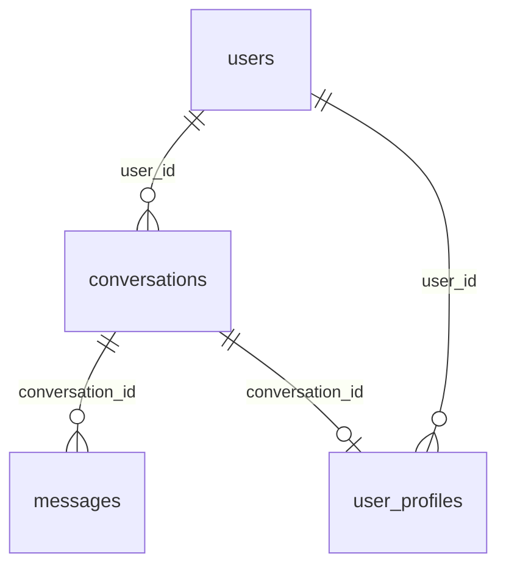

# ContentAlchemy — Database and Deployment Guide

How to set up MongoDB, build and run the containers, configure environments and deploy ContentAlchemy.

| File | Purpose |
|---|---|
| [`scripts/init_mongodb.js`](../scripts/init_mongodb.js) | Creates collections, indexes and validators; seeds the default user |
| [`Dockerfile`](../Dockerfile) | Streamlit app image (Python 3.13-slim, non-root, healthcheck) |
| [`docker-compose.yml`](../docker-compose.yml) | App + MongoDB 8 + Azurite + one-shot blob container setup |
| [`.dockerignore`](../.dockerignore) | Keeps `.env`, `.venv`, logs and tests out of the image |
| [`.env.example`](../.env.example) | Template for every setting |

---

## 1. MongoDB data model

Database: `MONGODB_DATABASE` (default `contentalchemy_db`). Four collections, all written through `src/repositories/`.



### 1.1 `users`

| Field | Type | Notes |
|---|---|---|
| `user_id` | string | e.g. `usr_local_001` (`CONTENTALCHEMY_USER_ID`) |
| `username` | string | Shown in the agents' greeting |
| `auth_provider` | string | `local` today; the identity provider later |
| `auth_subject` | string | Subject from the identity provider (defaults to `user_id`) |
| `is_active` | bool | |
| `created_at` | date | |

### 1.2 `user_profiles`

One Markdown LinkedIn profile per user per conversation (`profile_repository`).

| Field | Type |
|---|---|
| `user_id`, `conversation_id` | string |
| `profile_markdown` | string |
| `created_at`, `updated_at` | date |

> The live graph does not write this collection yet: LinkedIn answers stay in graph state and are stored as `answer`
> messages. `src/utils/save_user_profile.py` and the repository are ready for when that is wired in.

### 1.3 `conversations`

One per request (`conversation_repository`).

| Field | Type | Notes |
|---|---|---|
| `conversation_id` | string | `conv_<32 hex>`; also the LangGraph `thread_id` |
| `thread_id` | string | Same value as `conversation_id` |
| `user_id` | string | Owner; part of every query filter |
| `content_type` | enum | `research`, `seo_blog`, `linkedin`, `image`, `strategy`, `multi`, `chat` |
| `title` | string | First 60 characters of the request |
| `topic`, `target_audience`, `tone` | string | From the request and brand-voice settings |
| `status` | enum | `active` → `awaiting_approval` → `completed` / `archived` / `failed` |
| `metadata` | object | `keywords`, `approval_status`, `error`, `deliverables` (multi), `removed_from_dashboard` |
| `last_message_sequence` | int | Counter incremented atomically by `add_message` |
| `created_at`, `updated_at` | date | `updated_at` changes on every new message |

### 1.4 `messages`

Every turn, draft and decision, ordered by `sequence` within a conversation (`message_repository`).

| Field | Type | Notes |
|---|---|---|
| `message_id` | string | `msg_<32 hex>` |
| `conversation_id`, `user_id` | string | |
| `sequence` | int | 1, 2, 3 … per conversation |
| `role` | enum | `user`, `assistant`, `system`, `tool` |
| `message_type` | string | `request`, `question`, `answer`, `generated_content`, `generated_image`, `review`, `final_content`, `error`, `chat` |
| `content_type` | enum | As for conversations |
| `content` | any | Text, or a structured draft (blog JSON, LinkedIn fields, `{research_report, content_strategy}`) |
| `agent_name` | string \| null | e.g. `research_agent`, `content_generator`, `image_review` |
| `metadata` | object | `status`, `version`, `content_text`, `quality_*`, `image_*`, `options`, `review_action`, `deliverable` |
| `status` | string | Set on image messages (`generated`, `pending`, `approved`, `rejected`) |
| `created_at`, `updated_at` | date | |

Example `generated_content` message for a blog:

```json
{
  "message_id": "msg_3f…",
  "conversation_id": "conv_9a…",
  "user_id": "usr_local_001",
  "sequence": 4,
  "role": "assistant",
  "message_type": "generated_content",
  "content_type": "seo_blog",
  "content": { "seo_title": "…", "meta_description": "…", "blog_article": "…", "sources": [ … ] },
  "agent_name": "content_generator",
  "metadata": {
    "status": "draft", "version": 1, "content_text": "# …",
    "quality_score": 78, "quality_grade": "Good",
    "quality_details": { … }, "quality_suggestions": [ … ]
  },
  "created_at": { "$date": "2026-11-13T10:15:00Z" }
}
```

### 1.5 Indexes

| Collection | Index | Keys | Unique | Serves |
|---|---|---|---|---|
| `users` | `uq_user_auth` | `auth_provider, auth_subject` | ✓ | `create_user` upsert |
| `users` | `uq_user_id` | `user_id` | ✓ | `get_user_by_id`, `update_username` |
| `user_profiles` | `uq_profile_user_conversation` | `user_id, conversation_id` | ✓ | profile lookups |
| `conversations` | `uq_conversation_id` | `conversation_id` | ✓ | every lookup and `add_message` |
| `conversations` | `uq_conversation_thread_id` | `thread_id` | ✓ | thread ↔ conversation mapping |
| `conversations` | `ix_conversations_user_updated` | `user_id, updated_at ↓` | | History sidebar |
| `conversations` | `ix_conversations_user_status_updated` | `user_id, status, updated_at ↓` | | Content dashboard (`status="completed"`) |
| `messages` | `uq_message_id` | `message_id` | ✓ | `get_message`, `update_message` |
| `messages` | `uq_message_conversation_sequence` | `conversation_id, sequence` | ✓ | Ordering and pagination; prevents sequence collisions |
| `messages` | `ix_messages_conversation_created` | `conversation_id, created_at` | | Time-ordered reads within a conversation |
| `messages` | `ix_messages_user_type_created` | `user_id, message_type, created_at ↓` | | Dashboard (`list_user_messages_by_type`); **added by the init script** |

Notes:

- **The app never creates the `conversations` and `messages` indexes itself**; the repositories' `ensure_indexes()`
  functions exist but are not called. Run the init script. (The development database already had them from an earlier
  setup, but `users` had no indexes.)
- `message_repository.ensure_indexes()` declares `ix_messages_conversation_created` on `(conversation_id, sequence)`,
  the same keys as the unique sequence index, which MongoDB rejects. The init script uses `(conversation_id,
  created_at)`, which matches the existing database.

### 1.6 Validators

The init script attaches a `$jsonSchema` validator to each collection with `validationLevel: "moderate"` and
`validationAction: "warn"`. Violations are **logged, not rejected**, so the schema documents the expected shape
without risking writes. Once you have checked the MongoDB log for warnings, tighten it:

```javascript
db.runCommand({ collMod: "messages", validationAction: "error" })
```

---

## 2. Database initialization

`scripts/init_mongodb.js` is idempotent. It:

1. creates `users`, `user_profiles`, `conversations` and `messages` (or updates their validators if they already exist);
2. creates the indexes in §1.5 and skips any whose keys are already covered by an index with another name;
3. upserts the app user (`CONTENTALCHEMY_USER_ID`, display name `CONTENTALCHEMY_USERNAME`).

| Environment | Command |
|---|---|
| Local MongoDB | `mongosh "mongodb://127.0.0.1:27017" scripts/init_mongodb.js` |
| Custom database / user | `MONGODB_DATABASE=cms_prod CONTENTALCHEMY_USERNAME="Jordan" mongosh "$MONGODB_URI" scripts/init_mongodb.js` |
| MongoDB Atlas | `mongosh "mongodb+srv://<cluster>.mongodb.net/" --username <db-user> scripts/init_mongodb.js` |
| Docker Compose | Automatic on the **first** start (mounted into `/docker-entrypoint-initdb.d/`). To re-run: `docker compose exec mongodb mongosh /docker-entrypoint-initdb.d/init_mongodb.js` |
| Windows PowerShell | `$env:MONGODB_DATABASE="contentalchemy_db"; mongosh "mongodb://127.0.0.1:27017" scripts/init_mongodb.js` |

Expected output:

```
ContentAlchemy: initializing database "contentalchemy_db"
  collection users: created
  …
  index messages.ix_messages_user_type_created: ok
  user usr_local_001 ("Local User"): ready
ContentAlchemy: database initialization complete
```

A `FAILED` line on a unique index means existing documents contain duplicates. Find them before re-running, e.g.:

```javascript
db.messages.aggregate([
  { $group: { _id: { c: "$conversation_id", s: "$sequence" }, n: { $sum: 1 } } },
  { $match: { n: { $gt: 1 } } }
])
```

---

## 3. Docker

### 3.1 Image (`Dockerfile`)

| Aspect | Choice |
|---|---|
| Base | `python:3.13-slim` (matches the development Python) |
| Layers | `requirements.txt` installed before the code is copied, so code changes don't reinstall packages |
| Contents | `src/`, `.streamlit/`, `inputs/`, `scripts/` (no tests, docs, logs or secrets; see `.dockerignore`) |
| User | `appuser` (UID 1000); `/app/logs` and `/app/generated/images` writable |
| Port | 8501 |
| Healthcheck | `GET /_stcore/health` every 30 s |
| Command | `streamlit run src/web_app/streamlit_app.py --server.address=0.0.0.0 --server.port=8501` (headless, telemetry off) |

```bash
docker build -t contentalchemy .
docker run --rm -p 8501:8501 --env-file .env \
  -e MONGODB_URI="mongodb://host.docker.internal:27017" \
  -e AZURITE_BLOB_ENDPOINT="http://host.docker.internal:10000/devstoreaccount1" \
  contentalchemy
```

### 3.2 Compose stack (`docker-compose.yml`)

| Service | Image | Port | Volume | Role |
|---|---|---|---|---|
| `app` | built from `Dockerfile` | 8501 | `app-logs`, `app-images` | Streamlit UI and LangGraph workflow |
| `mongodb` | `mongo:8.0` | 27017 | `mongo-data` | Database; runs `init_mongodb.js` on first start; `mongosh ping` healthcheck |
| `azurite` | `mcr.microsoft.com/azure-storage/azurite` | 10000 | `azurite-data` | Blob storage emulator |
| `azurite-init` | the app image | — | — | One-shot: creates the blob container, then exits |

Start order: `mongodb` healthy **and** `azurite-init` finished → `app`.

```bash
cp .env.example .env               # add your API keys
docker compose up -d --build
docker compose ps                  # app: healthy, azurite-init: exited (0)
docker compose logs -f app
```

Settings the compose file overrides (everything else comes from `.env`):

| Variable | Value in compose | Why |
|---|---|---|
| `MONGODB_URI` | `mongodb://mongodb:27017` | Containers can't reach `127.0.0.1` on the host |
| `AZURITE_BLOB_ENDPOINT` | `http://azurite:10000/devstoreaccount1` | Same reason |
| `AZURITE_ACCOUNT_NAME` / `AZURITE_ACCOUNT_KEY` | `devstoreaccount1` and Azurite's public development key | Must match the emulator's built-in account |
| `AZURITE_CONTAINER_NAME` | from `.env`, default `contentalchemy-images` | Shared by `app` and `azurite-init` |

Operations:

| Task | Command |
|---|---|
| Rebuild after code changes | `docker compose up -d --build app` |
| Mongo shell | `docker compose exec mongodb mongosh contentalchemy_db` |
| Back up MongoDB | `docker compose exec mongodb mongodump --archive --db contentalchemy_db > backup.archive` |
| Restore MongoDB | `docker compose exec -T mongodb mongorestore --archive < backup.archive` |
| Stop, keep data | `docker compose down` |
| Stop and wipe data | `docker compose down -v` |

---

## 4. Environment and deployment configuration

### 4.1 Required vs optional settings

| Setting | Development | Production |
|---|---|---|
| `OPENAI_API_KEY` | required | required (also used directly by image prompts and chat) |
| `SERPAPI_KEY` and/or `TAVILY_API_KEY` | at least one | both, for fallback |
| `TEXT_PRIMARY_PROVIDER`, `TEXT_FALLBACK_PROVIDERS` | `openai` / optional | `openai` + at least one funded fallback |
| `ANTHROPIC_API_KEY`, `GEMINI_API_KEY`, `PERPLEXITY_API_KEY` | optional | for each provider listed as a fallback |
| `IMAGE_PRIMARY_PROVIDER`, `*_IMAGE_ENABLED`, provider keys | primary must be enabled | primary + one fallback |
| `MONGODB_URI`, `MONGODB_DATABASE` | local / compose | Atlas or managed MongoDB, TLS, a dedicated user |
| `AZURITE_*` | emulator defaults | A real Azure Storage account name, key, endpoint and container |
| `CONTENTALCHEMY_USER_ID` | default | One per deployment (no multi-user auth yet) |
| `LANGCHAIN_TRACING_V2`, `LANGCHAIN_API_KEY`, `LANGCHAIN_PROJECT` | optional | optional (sends prompts and outputs to LangSmith) |

Settings in older `.env` files that the code ignores: `DEFAULT_MODEL` (use `OPENAI_MODEL`) and `IMAGE_PROVIDER`.
`config/*.yaml` are empty and not loaded; environment variables are the only configuration source.

### 4.2 Environment profiles

`.env.development` (local Python):

```env
MONGODB_URI=mongodb://127.0.0.1:27017
MONGODB_DATABASE=contentalchemy_dev
AZURITE_BLOB_ENDPOINT=http://127.0.0.1:10000/devstoreaccount1
AZURITE_ACCOUNT_NAME=devstoreaccount1
AZURITE_ACCOUNT_KEY=<azurite development key>
TEXT_PRIMARY_PROVIDER=openai
TEXT_FALLBACK_PROVIDERS=gemini
IMAGE_PRIMARY_PROVIDER=stability
STABILITY_IMAGE_ENABLED=true
LANGCHAIN_TRACING_V2=false
```

`.env.production` (Atlas + Azure Storage):

```env
MONGODB_URI=mongodb+srv://contentalchemy-app:<password>@<cluster>.mongodb.net/?retryWrites=true&w=majority
MONGODB_DATABASE=contentalchemy_db
AZURITE_ACCOUNT_NAME=<storage-account>
AZURITE_ACCOUNT_KEY=<storage-account-key>
AZURITE_BLOB_ENDPOINT=https://<storage-account>.blob.core.windows.net
AZURITE_CONTAINER_NAME=contentalchemy-images
TEXT_PRIMARY_PROVIDER=openai
TEXT_FALLBACK_PROVIDERS=claude,gemini
IMAGE_PRIMARY_PROVIDER=stability
IMAGE_FALLBACK_PROVIDERS=openai
STABILITY_IMAGE_ENABLED=true
OPENAI_IMAGE_ENABLED=true
```

Despite the `AZURITE_` prefix, `image_storage.py` works against any Azure Blob endpoint. Note that it pins
`api_version="2026-06-06"`, which the real service must support.

`.gitignore` excludes `.env` and `.env.*` (except `.env.example`), and `.dockerignore` keeps them out of images.

### 4.3 Deployment options

| Option | Fits | Notes |
|---|---|---|
| **Docker Compose on one VM** | Demos, a single user or team | Simplest. Put Caddy or nginx in front for TLS and basic auth |
| **Azure Container Apps + MongoDB Atlas + Azure Storage** | Hosted single-user deployment | Store keys as Container Apps secrets; set **min replicas = max replicas = 1** (see below); enable session affinity |
| **Azure App Service (container)** | As above | Enable WebSockets (Streamlit needs them) and ARR affinity |
| **Streamlit Community Cloud** | Quick public demo | Put keys in `st.secrets` mapped to environment variables; needs hosted MongoDB and storage |

**Run a single replica.** The LangGraph checkpointer is in-memory (`MemorySaver`), so paused threads live in one
process. Several replicas, or a restart, lose in-flight reviews and image regeneration (drafts in MongoDB survive).
Scale out only after switching to a persistent checkpointer (see the
[design doc §9.2](technical-design-document.md#92-scaling-path)).

Streamlit-specific settings behind a proxy or load balancer:

```bash
streamlit run src/web_app/streamlit_app.py \
  --server.address=0.0.0.0 --server.port=8501 \
  --server.enableXsrfProtection=true
```

Make sure the proxy forwards WebSocket upgrades on `/_stcore/stream`.

### 4.4 Production checklist

- [ ] `scripts/init_mongodb.js` run against the production database (indexes created, user seeded)
- [ ] MongoDB user with `readWrite` on the app database only; TLS on; IP allow-list or private endpoint
- [ ] Blob container created; storage key held in a secret store; the Azurite development key not used
- [ ] Every enabled provider has a valid key **and** credit (Stability credits caused most image failures in testing)
- [ ] `OPENAI_IMAGE_MODEL` is a model the account can access
- [ ] Image storage defect addressed ([design doc §8.4](technical-design-document.md#84-image-storage)), otherwise image requests fail after upload
- [ ] Debug `print()` calls removed from `image_storage.py`
- [ ] Single replica (or a persistent checkpointer)
- [ ] TLS and authentication in front of Streamlit (the app has no login)
- [ ] Logs shipped (stdout) or the `app-logs` volume collected; `logs/contentalchemy.log` rotates at 5 MB × 3
- [ ] Healthcheck wired to the platform (`/_stcore/health`)
- [ ] MongoDB backups scheduled (Atlas backups or `mongodump`)
- [ ] Monthly spend limits set on each AI provider

### 4.5 Verifying a deployment

```bash
curl -fsS http://<host>:8501/_stcore/health         # → ok
docker compose exec mongodb mongosh --quiet contentalchemy_db \
  --eval 'db.conversations.getIndexes().map(i => i.name)'
```

Then in the UI:

1. Pick **Research**, run *"Research AI adoption trends in B2B marketing"*, approve it. It should appear in History and the Content dashboard.
2. Pick **Image**, run *"A minimalist square logo of a lightbulb, standard quality, for a website"*, approve and download it.
3. Check `logs/contentalchemy.log` for `Node finished … Status: completed` lines and the provider that served each call.
