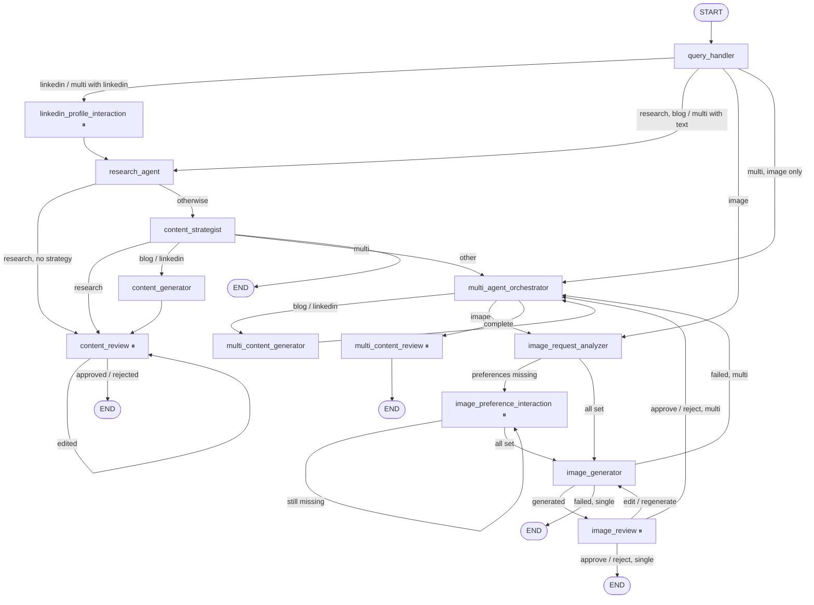

# ContentAlchemy — Technical Design Document

| | |
|---|---|
| **System** | ContentAlchemy, a multi-agent AI content marketing assistant |
| **Scope** | `src/` as of branch `feature/optimization-guardrails` (November 2026) |
| **Audience** | Engineers maintaining or extending the system, and reviewers assessing its design |
| **Related** | [Architecture](architecture.md) · [API Reference](api-reference.md) · [Service Comparison](service-comparison.md) · [Deployment Guide](deployment-guide.md) |

---

## 1. Goals and constraints

**Goals**

1. Turn one natural-language request into research reports, SEO blogs, LinkedIn posts, images, or several of these at once.
2. Keep the human in control: nothing is marked final without an explicit approve, edit or reject.
3. Ground factual content in real web sources, and make it hard for the model to invent citations.
4. Stay available when a single AI vendor fails, runs out of quota or rate-limits.
5. Keep the per-request cost low enough for individual use.

**Constraints**

- Single-user, single-process Streamlit deployment (the user is `CONTENTALCHEMY_USER_ID`, default `usr_local_001`).
- LLM output is untrusted: it may be malformed JSON, contain fabricated URLs or carry instructions injected from web pages.
- Image generation is slow (5–60 s) and billed per image; text generation is billed per token.

---

## 2. Architecture decisions and trade-offs

Each decision is written as *context → decision → consequences*.

### ADR-1 · LangGraph `StateGraph` as the orchestrator

- **Context.** The workflows branch by intent, loop on review edits and image regeneration, and must stop
  mid-run to ask the user a question.
- **Decision.** Model the system as one `StateGraph(ContentState)` (`src/core/workflow.py`) with conditional edges, and
  pause with `langgraph.types.interrupt()`.
- **Consequences.** Routing is explicit and testable (`tests/test_workflow.py` compiles the graph, and
  `test_multi_content_workflow.py` drives it). Pause and resume come with the framework. The cost is that every node
  must be safe to **re-execute from its start on resume**, because LangGraph replays the interrupted node (see §5.3).

### ADR-2 · One graph for every content type

- **Context.** Research, blog, LinkedIn, image and multi-content share steps (research, strategy, review).
- **Decision.** One graph; the `query_handler` sets `intent`, and routers choose the path. Multi-content reuses the
  single-deliverable nodes through an orchestrator loop rather than a separate graph.
- **Consequences.** Shared nodes are written once. The trade-off is that nodes branch on `intent`
  (`content_generator`, `image_generator`, `route_after_image_review`), so adding a content type touches several
  routers.

### ADR-3 · Thread ID = conversation ID, in-memory checkpointer

- **Decision.** `thread_id = conversation_id` (`assistant.thread_config`), with
  `build_workflow(checkpointer=MemorySaver())` cached by `st.cache_resource`.
- **Consequences.** Zero infrastructure and instant resume. However, paused threads are lost on restart and are not
  shared between processes. The UI falls back to MongoDB: after a restart a text draft can still be approved or
  rejected (`submit_decision` applies the review rules itself), but an image can no longer be edited or regenerated.
  The production path is a persistent checkpointer (§9).

### ADR-4 · Provider abstraction with ordered fallback

- **Decision.** Text goes through `TextProviderManager` (OpenAI, Claude, Gemini, Perplexity) and images through
  `ImageProviderManager` (Stability, OpenAI, Gemini). Search goes through `search_web` (SerpApi → Tavily). Order is
  configuration, not code.
- **Consequences.** A quota or outage at one vendor degrades quality, not availability. Prompts must be
  provider-neutral, and JSON-mode differences are handled by tolerant parsing (code-fence stripping) plus Pydantic
  validation rather than vendor features.

### ADR-5 · MongoDB as the system of record; checkpointer only for live state

- **Decision.** Every question, answer, draft, review and final piece is a document in `messages`, ordered by a
  per-conversation `sequence`. The checkpointer holds only in-flight graph state.
- **Consequences.** History, the Content dashboard and reopening old conversations do not depend on graph state.
  Drafts are heterogeneous (blog JSON, LinkedIn fields, image metadata), which suits a document store.

### ADR-6 · Guardrails as code (Pydantic + heuristics) rather than an LLM judge

- **Decision.** Deterministic validators: Pydantic schemas with `extra="forbid"`, regex injection heuristics, URL
  grounding, output-safety regexes and a rule-based quality score.
- **Consequences.** Free, fast (schema and grounding checks never exceeded 16 ms in the logs), predictable and
  unit-tested (56 guardrail tests). The limit is that
  they cannot judge factual accuracy or tone, so those are left to the human reviewer.

### ADR-7 · Strategy and research report in a single LLM call

- **Decision.** The Content Strategist asks for both deliverables in one response, separated by
  `---CONTENT_STRATEGY_START---`.
- **Consequences.** One call instead of two, and the strategy is consistent with the report. The trade-off is that it
  is the longest call in the system (median 21 s, `max_output_tokens=7000`), and a missing separator fails the node.

### ADR-8 · Stream only the blog article

- **Decision.** The SEO blog writer streams JSON from `TextProviderManager.stream_text`. `JsonStringFieldStreamer`
  extracts the `blog_article` field incrementally and emits it to the UI with LangGraph's `get_stream_writer()`
  (`stream_mode="custom"`).
- **Consequences.** The user watches the article appear while the full JSON (metadata, FAQs, sources) is still
  validated at the end. Fallback is possible only **before the first chunk**; after that a failure surfaces as an
  error so text isn't duplicated or mixed between providers.

---

## 3. LangGraph workflow

### 3.1 Graph



### 3.2 Routers

| Router | After | Logic (from `workflow.py` and the agents) |
|---|---|---|
| `route_after_query_handler` | `query_handler` | `route_by_intent` rejects unknown intents. `multi` → `linkedin` if requested, else `research` if any of research/strategy/blog/linkedin is requested, else straight to the orchestrator |
| `route_after_research` | `research_agent` | `intent == "research"` and no `strategy` requested → `content_review`; otherwise → `content_strategist` |
| `route_after_strategy` | `content_strategist` | `research` → review · `linkedin`/`blog`/`seo_blog` → generator · `multi` → orchestrator · anything else → END (logged warning) |
| `route_after_review` | `content_review` | `approval_status == "edited"` → back to `content_review`; otherwise END |
| `route_multi_agent` | `multi_agent_orchestrator` | `next_agent` empty → `multi_content_review`, otherwise the deliverable name |
| `route_image_preferences` | analyzer and interaction | any of the 4 preferences missing → ask, otherwise generate |
| `route_after_image_generation` | `image_generator` | `image_status == "failed"` → orchestrator (multi) or END; otherwise → `image_review` |
| `route_after_image_review` | `image_review` | multi + approve/reject → orchestrator; otherwise the action (`edit`/`regenerate` → generator, `approve`/`reject` → END) |

### 3.3 Node instrumentation

Every node is wrapped by `track_node_execution`, which logs start and finish with the status (`completed`,
`interrupted` when `GraphInterrupt` is raised, or `failed`) and the elapsed time. Interrupts are re-raised untouched
so LangGraph can pause.

---

## 4. State management

### 4.1 `ContentState`

`ContentState` (`src/core/state.py`) is a `TypedDict(total=False)`: every field is optional, and nodes return only
the keys they change. LangGraph merges the returned partial dict into the thread state. Only `messages` has a reducer
(`add_messages`, which appends); every other key is **last write wins**.

| Group | Fields |
|---|---|
| Identity | `user_id`, `conversation_id`, `user_request` |
| Analysis | `intent`, `topic`, `target_audience`, `tone`, `keywords`, `objective`, `requested_agents` |
| Research | `research_results` (sources), `research_summary`, `research_data` (validated JSON), `research_report` |
| Strategy | `content_strategy` |
| LinkedIn | `linkedin_profile_answers` (and draft fields kept for compatibility) |
| Image | `image_purpose`, `image_visual_style`, `image_orientation`, `image_quality`, `image_style`, `image_prompt`, `image_path`, `image_url`, `image_status`, `image_review_action`, `image_error`, `image_preference_error`, `image_generation_count`, `generated_image_message_id` |
| Draft / review | `current_content`, `edited_content`, `final_content`, `current_agent`, `generated_content_message_id`, `review_action`, `approval_status`, `human_interaction` |
| Quality | `quality_score`, `quality_grade`, `quality_details`, `quality_suggestions` |
| Multi-content | `requested_agents`, `multi_agent_results`, `multi_agent_status`, `next_agent` |
| Bookkeeping | `completed_agents`, `errors`, `messages` |

### 4.2 Precedence rules

- **Explicit UI settings beat LLM analysis.** `query_handler_node` keeps `intent`, `target_audience`, `tone`,
  `keywords`, `objective` and `requested_agents` from the initial state when they are set, and fills only the gaps
  from the LLM. A content type picked in the sidebar therefore always wins over classification.
- **State beats the conversation document.** Agents read `topic`, `tone` and `target_audience` from state first, then
  fall back to the MongoDB conversation.
- **Image preferences already in state are kept.** The analyzer merges only newly found preferences.

### 4.3 Multi-content result map

`multi_agent_results` is keyed by deliverable (`research`, `strategy`, `blog`, `linkedin`, `image`). Each value is
`{content, content_text, message_id, status, quality_*?, review_action?}`. The orchestrator skips any deliverable
whose status is `draft`, `generated`, `completed`, `approved`, `rejected` or `failed`. `research` and `strategy` are
filled by the Content Strategist and share one MongoDB message.

### 4.4 Two stores, two lifetimes

| Store | Holds | Lifetime |
|---|---|---|
| `MemorySaver` checkpointer | Full `ContentState` per thread, pending interrupts | Process lifetime |
| MongoDB | Conversations, messages (drafts, decisions, final content), profiles, users | Durable |

---

## 5. Agent responsibilities and interactions

### 5.1 Responsibilities

| Agent | Input from state | LLM call (max output tokens) | Writes to state | Persists |
|---|---|---|---|---|
| Query handler | `user_request` | 1 × classification (700) | analysis fields | — |
| LinkedIn profile interaction | — | — | `linkedin_profile_answers` | — (the UI records answers as `answer` messages) |
| Research agent | `topic`, `target_audience` | 1 × synthesis (3,000) | `research_data`, `research_results`, `research_summary`, `current_content` | `generated_content` (research JSON + Markdown) |
| Content strategist | `research_data`, brand voice | 1 × report + strategy (7,000) | `research_report`, `content_strategy`, multi results | `generated_content` `{research_report, content_strategy}` |
| Content generator | report, strategy, profile, brand voice | LinkedIn (1,600) or streamed blog (4,000) | draft, quality fields | `generated_content` with quality metadata |
| Content review | `current_content` | — | `approval_status`, `final_content` | updates the draft message status / text |
| Image request analyzer | `user_request` | 1 × extraction (200), OpenAI direct | found preferences | — |
| Image preference interaction | missing preferences | — | one preference per run | — |
| Image generator | request / edited prompt, preferences | 1 × prompt enhancement (500), OpenAI direct; skipped on *regenerate* | `image_*` fields | `generated_image` (created, or updated on regeneration) |
| Image review | `image_path`, `image_prompt` | — | `image_review_action`, `image_status` | updates the image message |
| Multi orchestrator | `requested_agents`, results | — | `next_agent`, `multi_agent_status` | — |
| Multi generator / review | `next_agent`, results | as the generator | `multi_agent_results` | one message per deliverable |

### 5.2 Interaction pattern

Agents never call each other. They communicate only through `ContentState` and are sequenced by edges. The one
exception is the legacy tool-calling SEO agent in `agents/blog_writer.py` (`create_agent` with the
`call_content_research_agent` and `internet_search` tools in `src/tools/`). It is **not registered in the graph**;
`content_generator` imports only its parsing, validation and formatting helpers.

### 5.3 Re-execution safety

When a node calls `interrupt()`, LangGraph stops it. On resume it **re-runs the node from the top**, returning the
stored answer from each `interrupt()` call in order. The design accounts for this:

- **Image preferences:** one question per node run, so a resume never replays earlier questions or the LLM
  extraction.
- **LinkedIn profile:** asks all five questions in one node. Earlier answers are replayed from the checkpoint, and
  the node does no external I/O before its interrupts.
- **Reviews:** `interrupt()` is the first side-effecting action; MongoDB updates happen only after the decision.
- **Multi content review:** loops over deliverables with one `interrupt()` each. Updates for deliverables reviewed
  earlier are repeated on replay, but they are idempotent `$set` operations.

---

## 6. Human-in-the-loop design

### 6.1 Pause points

| Node | `interaction_type` | Options | Resume value |
|---|---|---|---|
| `linkedin_profile_interaction` | `linkedin_profile_question` | multi-select + Other | `{"selected_options": [...], "other_text": ""}` |
| `image_preference_interaction` | `image_preference_question` | single-select (+ Other for purpose/style), `is_last` flag | `{"selected_options": [...], "other_text": ""}` |
| `content_review` | `content_review` | approve / edit / reject | `{"action": "...", "edited_content": "..."}` |
| `multi_content_review` | `content_review` (+ `multi`, `deliverable`) | approve / edit / reject | same |
| `image_review` | `image_review` | approve / edit / regenerate / reject | `{"action": "...", "edited_prompt": "..."}` |

### 6.2 Decision semantics

| Decision | Single text | Multi text | Image |
|---|---|---|---|
| Approve | `approved` → END; UI saves `final_content` and marks the conversation `completed` | `approved` | `approved` → END (single) or back to the orchestrator (multi) |
| Edit | Re-scored, `edited` → **back to review** | Edit is final (`approved`), re-scored | New prompt → regenerate (prompt enhanced again) |
| Regenerate | — | — | Same enhanced prompt → new image (no LLM call) |
| Reject | `rejected` → END; conversation `archived` | `rejected` | `rejected` |

### 6.3 UI loop

1. `start_agent()` creates the conversation, stores the `request` message and runs the graph until it pauses.
2. `record_pause()` stores a question as a `question` message, or sets the conversation to `awaiting_approval` for reviews.
3. The UI renders the payload (options, draft, quality score, image). The user's response goes to
   `answer_question()`, `submit_decision()` or `submit_image_decision()`, which resume with `Command(resume=...)`.
4. Multi-content runs step by step with `advance_multi()` (`interrupt_after=MULTI_STEP_NODES`), so the UI can show
   progress per deliverable tab; `finalize_multi()` saves every approved piece.

Invalid answers are handled in the node rather than crashing it. An image preference that doesn't normalise (e.g.
orientation "diagonal") sets `image_preference_error`, and the same question is asked again with *"Please choose one
of: …"*.

---

## 7. Guardrails and quality validation

### 7.1 Layers

```
user request ──► UserRequestInput (3–5,000 chars)
LLM analysis ──► QueryAnalysisOutput (closed intent enum, ≤20 keywords, 1–5 unique deliverables)
search results ─► prompt-injection heuristics (log-only)
LLM research ──► ResearchOutput schema ──► grounding: every cited URL ∈ search results
LLM drafts ────► LinkedIn / blog field checks ──► output safety (unsafe markup, placeholders, length)
                 ──► source URL filter (blog) ──► quality score ──► human review
```

### 7.2 Guardrail catalogue

| Guardrail | Module | Enforcement | Rules |
|---|---|---|---|
| Request input | `input_guardrails.UserRequestInput` | Reject | Stripped, 3–5,000 characters, no extra fields |
| Query analysis | `input_guardrails.QueryAnalysisOutput` | Reject | `intent` ∈ research/blog/linkedin/image/strategy/multi; topic 2–300; ≤ 20 keywords of 1–100 chars, de-duplicated; 1–5 unique deliverables |
| Prompt injection | `prompt_injection_guard.check_prompt_injection` | **Log only** | 5 regex families: ignore-previous-instructions, reveal-system-prompt, role-override, instruction-override, secret-extraction. Applied to the topic and to every text field of every search result (URLs skipped) |
| Research schema | `research_guardrails.ResearchOutput` | Reject | 1–30 findings, each with a claim (3–1,000), explanation (≤ 3,000) and 1–10 `HttpUrl`s; summary 10–5,000; 1–20 sources |
| Grounding | `grounding_guardrails.validate_research_grounding` | Reject | Every finding URL and every source URL, after normalisation (scheme/host lower-cased, default port and fragment dropped, trailing slash trimmed, query kept), must appear in the original search results |
| Search URL filter | `serp_client.is_valid_source_url` | Drop | Only http(s); `google.com` and subdomains removed |
| Tool input | `tool_guardrails` | Reject | Topic 2–300, audience ≤ 300, keyword ≤ 100 (legacy tool agent) |
| LinkedIn output | `content_output_guardrails.validate_linkedin_output` | Reject | hook ≤ 500, body ≤ 5,000, CTA ≤ 500, ≤ 15 hashtags matching `#[A-Za-z0-9_]+` |
| Blog output | `content_output_guardrails.validate_blog_output` | Reject | 11 required fields; article ≤ 30,000; SEO title ≤ 100; meta ≤ 300; CTA ≤ 1,000 |
| Output safety | `content_output_guardrails.validate_content_text` | Reject | `<script>`, `<iframe>`, `<object>`, `<embed>`, `javascript:`, `on*=` handlers, and unresolved placeholders like `[insert …]` |
| Blog sources | `blog_writer.validate_source_urls` | Filter | Keeps only URLs that research actually returned |

The injection detector deliberately **does not block**: false positives on legitimate security articles would stop
research. Its defence is containment instead. Search results reach the model as JSON data under a system prompt that
asks for strict JSON output, and the grounding check rejects any output that cites sources outside the search results.

### 7.3 Quality score

`utils/quality_validation.evaluate_content_quality` returns `{score, grade, checks, suggestions}`.

| LinkedIn check | Max | Full marks when |
|---|---|---|
| Hook | 20 | First line works as a hook (rules in `_score_linkedin`, e.g. not a Markdown heading) |
| Readability | 20 | 100–800 words (partial for 50–99 or 801–1,200) |
| Call to action | 20 | CTA phrasing detected |
| Hashtags | 20 | 3–5 hashtags (partial for 1–2 or 6–8) |
| Structure | 20 | ≥ 3 paragraphs (10 otherwise) |

| Blog check | Max | Full marks when |
|---|---|---|
| SEO title | 15 | Present and contains the primary keyword |
| Meta description | 15 | 120–160 characters and contains the keyword |
| Headings | 20 | ≥ 4 headings (partial for ≥ 2) |
| Keyword usage | 15 | At least two target keywords used |
| Article length | 20 | ≥ 1,000 words (tiers at 600 and 300) |
| Call to action | 15 | CTA present |

Grades: **Excellent** ≥ 85 · **Good** ≥ 70 · **Needs Improvement** ≥ 50 · **Poor** < 50. Edited drafts are re-scored
before they return to review.

---

## 8. Provider integrations and fallback patterns

### 8.1 Text: `TextProviderManager`

```
for provider in [TEXT_PRIMARY_PROVIDER, *TEXT_FALLBACK_PROVIDERS] (unknown names skipped, de-duplicated):
    for attempt in 0..MAX_RETRIES (2):
        try provider.generate_text(...) → return
        retryable error  → sleep 1s · 2^attempt, retry
        non-retryable    → next provider
raise TextProviderManagerError(list of (provider, reason))
```

Each client maps vendor exceptions to one error taxonomy (`providers/text/text_provider_errors.py`), and the SDK's own
retries are disabled (`max_retries=0`) so only the manager retries:

| Error | Retryable | Typical cause |
|---|---|---|
| `TextProviderRateLimitError` | yes | HTTP 429 |
| `TextProviderTemporaryError` | yes | Timeout, connection error, 5xx, overloaded, empty stream |
| `TextProviderQuotaError` | no → fallback | Billing / quota exhausted |
| `TextProviderAccessError` | no → fallback | Missing or invalid key |
| `TextProviderRequestError` | no → fallback | Bad request, unsupported model |

The **streaming** variant adds one rule: once any chunk has been yielded, errors are raised immediately, with no retry
and no fallback. All clients use a 60 s timeout.

| Provider | SDK / endpoint | Default model |
|---|---|---|
| OpenAI | `openai` Responses API | `gpt-4o-mini` (`OPENAI_MODEL`) |
| Claude | `anthropic` Messages API | `claude-sonnet-5-5` |
| Gemini | `google-genai` `generate_content` | `gemini-2.5-flash` |
| Perplexity | `openai` SDK, `base_url=https://api.perplexity.ai/v1` | `perplexity/sonar` |

**Exceptions to the manager.** The image preference extractor, the image prompt enhancer and general chat
(`assistant.chat_reply`) call `openai_client.generate_text` directly, so they have no retries and no fallback. If
OpenAI is down, image requests and chat fail while research, blog and LinkedIn still work. Routing these through
`text_provider_manager` would close the gap.

### 8.2 Images: `ImageProviderManager`

- Providers are registered only when `<NAME>_IMAGE_ENABLED=true`. The primary must be registered or startup raises
  `Unsupported image provider`.
- Providers are tried once each, in order (no retries). Each returns PNG bytes.
- If **every** failure was `InsufficientCreditsError`, that specific error is raised, giving the user the *"insufficient
  credits"* message. Otherwise a generic `ImageProviderError` is raised.
- `image_generator_node` turns both into `image_status="failed"` with a friendly message. The graph ends a single
  image request; in multi-content it returns to the orchestrator and the other deliverables continue.

| Provider | API | Size handling |
|---|---|---|
| Stability | `POST /v2beta/stable-image/generate/core`, `output_format=png` | 1:1, 9:16, 16:9 aspect ratios; 402 → credits, 401/403 → access, 429 → rate limit, 5xx → temporary |
| OpenAI | `images.generate`, base64 output | Maps to 1024×1024 / 1024×1536 / 1536×1024 (`1792×1024` is not mapped and falls back to square) |
| Gemini | `generate_content` with `response_modalities=["IMAGE"]` | Aspect ratio; 402/429/quota terms → credits; blocked prompts surfaced |

### 8.3 Search: `search_web`

SerpApi Google (`num` = 1–10, `no_cache=True`) first; Tavily (`search_depth="basic"`) when SerpApi raises **or** returns
no valid URLs. If both fail it returns `[]`, and the research agent stops with *"No search results found"*. Missing
keys are treated as "provider unavailable", not as errors.

### 8.4 Image storage

`AzuriteImageStorage` uploads PNGs to `<container>/<conversation_id>/image_<uuid>.png`. `ImageStorageManager` adds a
fallback to `generated/images/` on local disk. **Known defect:** `image_clients.py` instantiates
`AzuriteImageStorage` directly, whose `upload_image()` returns a URL string, while the caller indexes it as a dict
(`storage_result["image_path"]`). The image is uploaded, but the step then raises `TypeError`. The review UI also reads
images with `Path(path).read_bytes()`, so it can only display locally stored files. Switching to
`ImageStorageManager` and serving blobs through a download (or SAS URL) resolves both.

---

## 9. Scalability, reliability and observability

### 9.1 Current limits

| Area | Today | Limit |
|---|---|---|
| Users | One configured user ID | No authentication or tenancy in the UI (repositories already scope every query by `user_id`) |
| Processes | One Streamlit process; graph cached per process | `MemorySaver` is per process, so paused threads don't survive restarts or load balancing |
| Concurrency | Graph runs synchronously in the Streamlit script thread | Long nodes (20–60 s) block that session's reruns |
| Data | Indexed queries, history capped at 30, dashboard reads ≤ 200 messages | Fine for thousands of conversations per user |

### 9.2 Scaling path

1. **Persistent checkpointer.** Replace `MemorySaver` with `langgraph-checkpoint-mongodb` (same database) or the
   Postgres saver. This removes the restart limitation and allows several app replicas behind a load balancer with
   sticky sessions.
2. **Authentication.** Map the identity provider's subject to `users.auth_subject` (already modelled by
   `create_user(auth_provider, auth_subject)`) and stop using the `CONTENTALCHEMY_USER_ID` constant.
3. **Background execution.** Move graph runs to a worker (e.g. LangGraph Server, Celery/RQ) and have the UI poll or
   stream from it; keep Streamlit as a thin client.
4. **Rate and cost controls.** Per-user daily token and image quotas, enforced before calling providers.
5. **Caching.** Cache `search_web` results by query (SerpApi already has a server cache, but the code sends
   `no_cache=True`) and research output by topic for a short TTL.

### 9.3 Reliability mechanisms

| Mechanism | Where |
|---|---|
| Bounded exponential-backoff retries (2 retries; 1 s, 2 s) | `TextProviderManager` |
| Ordered vendor fallback for text, images and search | provider managers, `search_web` |
| Stream-safe fallback (none after the first chunk) | `stream_text` |
| Graceful image degradation (multi continues) | `route_after_image_generation`, orchestrator |
| Failure recording (`error` message, conversation `failed`) | `assistant.record_failure` |
| Atomic per-conversation sequence numbers (`$inc` with `find_one_and_update`) | `message_repository.add_message` |
| Ownership checks (`user_id` in every filter) | all repositories |
| MongoDB fast-fail (`serverSelectionTimeoutMS=5000`) and UI degradation (empty history instead of a crash) | `mongodb_client`, `assistant.list_history` |
| Multi-content retry from the last checkpoint after a failed step | `advance_multi` |

### 9.4 Observability

- **Logs.** `setup_logger` writes to stdout and `logs/contentalchemy.log` (rotating, 5 MB × 3), formatted
  `time | logger | level | message`.
- **Node timing.** `track_node_execution` logs each node's status and duration; `run_workflow` logs whole runs.
- **Step timing.** The research agent logs search, injection scan, context, LLM, parsing, validation and grounding
  durations separately. Provider managers log each attempt, retry, fallback and success.
- **Tracing.** Set `LANGCHAIN_TRACING_V2=true`, `LANGCHAIN_API_KEY` and `LANGCHAIN_PROJECT` to send LangGraph traces to
  LangSmith.
- **Health.** Streamlit exposes `/_stcore/health`, which the Dockerfile healthcheck uses; MongoDB has `ping`
  (`check_mongodb_connection()`).

Suggested production metrics: provider success rate and fallback count per provider, p50/p90 node latency, image
failure reasons, review outcomes (approve/edit/reject ratio) and quality-score distribution.

---

## 10. Security considerations

| Topic | Status |
|---|---|
| Secrets | `.env` (gitignored, excluded from the Docker build by `.dockerignore`); never logged by the clients |
| Debug output | `image_storage.py` prints whether the Azurite key loaded, its length and whether it is valid base64 at import. It doesn't print the key, but should be removed |
| Prompt injection | Heuristic detection (log-only), JSON-data framing and grounding checks; no tool execution in the live graph |
| Output safety | Unsafe HTML/JS rejected before persistence |
| Data isolation | Every repository query filters by `user_id`; conversations and messages also check ownership before writes |
| Search results | Google-hosted URLs filtered; only http(s) accepted |

---

## 11. Known gaps and recommended next steps

| # | Gap | Recommendation |
|---|---|---|
| 1 | Image storage type mismatch (§8.4) | Use `ImageStorageManager`; serve blobs to the UI |
| 2 | Image and chat prompts bypass text fallback | Route through `text_provider_manager` |
| 3 | `image_clients.generate_image` always reports `provider="stability"` | Return the provider name from `ImageProviderManager` |
| 4 | Checkpoints lost on restart | Persistent checkpointer |
| 5 | `ensure_indexes()` for conversations and messages is never called | Run `scripts/init_mongodb.js` (or call them at startup). Note `message_repository.ensure_indexes()` declares `ix_messages_conversation_created` on the same keys as the unique sequence index, which MongoDB rejects |
| 6 | LinkedIn profile answers are not persisted to `user_profiles` | Call `upsert_profile` after the questions, and skip questions already answered |
| 7 | `DEFAULT_MODEL` / `IMAGE_PROVIDER` in `.env` are unused, and `config/*.yaml` is empty | Remove them or wire them in |
| 8 | Script-style test files run on import | Wrap them in `if __name__ == "__main__":` or move them to `scripts/` |
